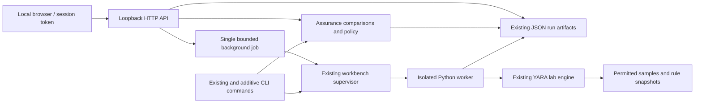
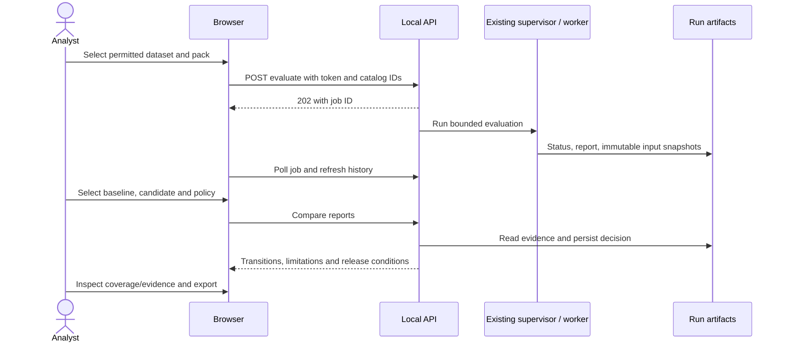

# Detection assurance workspace

This is an extension of malyz3r's existing evaluator and local workbench, not a second scanning engine. The supported deployment is one analyst on a local workstation. It is not a multi-user service or an independently certified detection product.

## Inspection findings and change inventory

Source inspection found working evaluation and report schemas in `lab.py`, subprocess supervision and persistent run directories in `workbench.py`/`worker.py`, atomic artifact exports in `artifacts.py`, strict rule comparisons and gates in `quality.py`, and confidence intervals in `statistics.py`. Dataset import, corpus inventory, scanner configuration, multi-provider assistant and MCP integrations already existed. There was no browser frontend, HTTP evaluation API or database-backed history to extend. These existing engines and command interfaces were preserved.

Added files: `malware_scanner/assurance.py` (sample comparisons, coverage, release gates and CLI), `malware_scanner/web.py` (local authenticated API and job adapter), the bundled files in `malware_scanner/web_assets/` (browser interface), `policies/release-example.json`, `workspace.example.json`, `tests/test_assurance.py`, `tests/browser_assurance.py`, and this guide. Modified files: `setup.py` for entry points/assets, `tests/smoke_install.py` for installation coverage, `README.md` for launch instructions and `VALIDATION.md` for actual results. There are no runtime dependency additions or schema migrations.

## Run it

From the repository root, install the package and start the web interface:

```sh
python -m pip install -c constraints.txt .
malyz3r-web --workspace . --catalog workspace.example.json
```

Open the **session URL printed by the server**. Its fragment contains the access token. The interface stores that token in this browser tab's session storage and removes it from the address bar. Reopening a tab after a server restart requires the newly printed URL. Do not share the URL.

Without a catalog, `malyz3r-web --workspace .` can browse existing `runs/` artifacts. `--runs` selects a workspace-relative run directory; `--port` defaults to 8765. Binding is deliberately restricted to `127.0.0.1`.

The catalog maps analyst-selected names to permitted local inputs:

```json
{
  "datasets": {"review-set": "local-corpus/review/manifest.json"},
  "rule_packs": {
    "baseline": "research_rules/baseline",
    "candidate": "research_rules/candidate"
  }
}
```

Catalog paths and sample paths must resolve within the workspace. Rules may include dependencies only within their rule directory, enforced by the existing compiler. The web interface does not accept arbitrary paths, sample uploads, or archives. The rule workbench accepts explicitly imported rule text into a separate draft. Use the existing corpus importer and manifest workflow to prepare inputs locally. The bundled example points at the **synthetic regression fixtures**, not real malware or a production benchmark.

## Complete analyst workflow

1. Prepare a permitted, deduplicated manifest using the existing lab schema. `target` means an explicitly expected rule is known; `benign` and `unknown` use empty `expected_rules` lists. Preserve hashes, family annotations, source provenance and split labels.
2. Register the dataset and two rule-pack directories in a local catalog. Keep rule identifiers stable for existing rule-specific comparisons. The evaluator requires expected rule IDs to exist in the selected pack.
3. Start the workspace. In **Evaluations**, choose the dataset and baseline pack, then run the evaluation. Repeat for the candidate pack.
4. Choose baseline and candidate evaluations at the top. **Release comparison** applies an editable JSON policy and shows sample transitions and a reasoned decision. Expand the metric details for confidence intervals and per-family/per-rule comparisons.
5. Open a changed sample to inspect its hash, label, expected rules, observed matches and scan status. **Coverage matrix** pivots observed family/rule counts; select a cell for its contributing evidence.
6. Export the comparison as JSON. The export contains actual backend results, policy conditions, input digests, limitations, and rule metrics. Policy decisions are also saved under the candidate run's `release-decisions/` directory and surfaced in history.

The history view shows observed metrics per evaluation. The quality overview plots up to 20 compatible evaluations among the latest 50 runs, checking manifest identity, actual sample hashes, annotations, engine and settings. Plot spacing represents evaluation order, not elapsed time. Earlier runs, failures, and unreadable artifacts remain visible. A failed worker has status but may have no report to inspect. No missing history is synthesized.

## Interactive analyst dashboard

The redesigned interface uses near-black surfaces, restrained status colors, responsive analytical layouts and a larger evidence workspace. Its quality overview links precision, recall, false positives and missed positives to the exact relevant sample outcomes. Throughput and duration are measured run observations; baseline differences and the compatible-history plot do not claim controlled performance experiments.

**Detection map:** searchable family, rule, sample and hash nodes; recorded file-type nodes appear only if the report contains that metadata. Pan, zoom, fit, node filters, keyboard selection and an evidence inspector are available. Solid edges represent observed matches/hashes; dashed edges represent dataset family annotations. There are no inferred rule-to-family coverage edges. Selecting a family highlights its sample relationships and adjacent observed rules. Family inspector counts cover the full selected evaluation, while relationship counts describe the visible page. Pages contain up to 50 samples, capped at 500 nodes and 1,000 edges. Missing file types and enrichment stay unknown.

**Rule workbench:** read a configured pack, select a source file, edit or import up to 12 KB of rule text, and choose Validate syntax or Evaluate draft. Each submission copies a bounded pack into `runs/rule-drafts/` and changes only the selected file in that copy. Dependencies are confined to the pack; copies are limited to 32 MiB and 1,000 files, with a 4 MiB per-file read limit. Validation uses the same supervised subprocess and memory/wall limits as evaluation, returns public rule counts and syntax diagnostics, and does not scan samples. Evaluation uses the selected permitted manifest. Original rule files are never overwritten. Draft pack IDs are available during the server session; draft files and evaluation snapshots persist, and can be explicitly registered in the catalog for a later session. There is no automatic rule promotion.

**Sample investigation:** a focused inspector shows the SHA-256, recorded size, label, family annotation, scan outcome, matching rules and matched string identifiers where available. Metadata not recorded in older reports remains unavailable. Sample reports export as JSON with evaluation, engine, settings and pack evidence. No sample bytes are displayed or executed.

`web_workspace.py` supplies the graph, compatibility-filtered history and draft adapters; `workspace.js` implements the corresponding browser views. The evaluator now records actual scanned byte length as an additive result field. Existing report consumers and CLI workflows remain supported.

## Scoring and compatibility

The original schema-v2 reports, `malyz3r-lab`, `malyz3r-workbench`, assistant, MCP and scanner commands remain compatible. No database migration is required. Existing JSON run directories are the persistence layer; rule-source snapshots and manifest digests remain owned by the workbench.

The new **sample-level** score counts a target as detected only if at least one explicitly expected rule matched. A benign sample is a false positive if any rule matched. Unknown labels and failed scans are excluded from correctness denominators. A wrong-rule match on a target does not establish a correct detection. The existing **per-rule** metrics retain their stricter expected-rule semantics, including matches on other targets as rule-specific false positives. These are intentionally distinct views.

Precision, recall, F1, false-positive and false-negative rates remain undefined when their denominator is zero. Confidence intervals reuse the existing Wilson implementation. Duration and throughput are observations from individual runs, not controlled performance experiments.

Comparisons align by SHA-256, reject missing/duplicate identities, and flag changed datasets, annotations, engine versions, settings, empty or incomplete evaluations. Changed rule-pack source digests are expected when comparing revisions. Added rule IDs can be displayed, but the original strict rule comparison remains unavailable if rule sets differ. Unknown labels retain unclassified transitions and prevent release approval.

Coverage cells count successfully scanned samples explicitly labelled for the rule, with a separate count for all applicable samples. Benign false positives are separate. `no_applicable_samples`, zero observed detections, incomplete scans, unknown families and insufficient evidence are distinct states. The fewer-than-five-samples marker is a visibility heuristic, not a significance test or a claim of family-wide coverage. Pages contain at most 50 family/rule cells; filter by rule or family for focused matrices. Cells outside a particular page are marked explicitly.

The graph presents only stored rule-match edges and dataset family annotations. Family annotations are not independently verified attribution. The UI caps displayed edges and exposes a sample evidence action on nodes. There is no fabricated enrichment, inference, or 3D rendering.

## Release policy and CI

```sh
malyz3r-assurance runs/BASELINE/report.json runs/CANDIDATE/report.json \
  --policy policies/release-example.json --output comparison.json
```

This is an additive command. The existing `malyz3r-workbench compare` and rule-policy format are unchanged. The release policy requires a string `version` and supports:

- `max_new_false_positives` and `max_regressions`: nonnegative sample-transition counts, default zero.
- `min_recall`: observed sample-level recall between zero and one.
- `min_samples`: minimum evaluated sample count.
- `max_duration_seconds`: maximum observed candidate duration.
- `require_provenance`: require nonempty recorded provenance for every candidate sample. This checks presence, not the truth or licensing of the source.
- `rule_policy`: an optional existing `check_policy` policy for rule-specific thresholds and confidence bounds. Use it when aggregate recall could hide a regression in an individual detector.

Completeness, compatible comparison inputs and known labels cannot be disabled. Decisions include conditions, required/actual values, policy version and digest, report digests, evaluation IDs and decision timestamp. Policy presence checks are not independent evidence verification. No rule is automatically promoted or published.

Exit codes: **0** pass, **2** invalid input/policy or operational error, **3** fail, **4** inconclusive. JSON is written to `--output` or stdout; errors produce a JSON error on stdout. A policy is optional for evidence-only comparisons; without one, exit 0 means comparable, not approved for release.

A CI job can run the command after generating both reports:

```yaml
- name: Compare evaluated rule packs
  run: >-
    malyz3r-assurance runs/baseline/report.json runs/candidate/report.json
    --policy policies/release-example.json --output comparison.json
```

Those paths are examples for reports your job creates, not pre-existing repository artifacts. Nonzero decisions fail the shell step.

## Boundaries and security

The browser requests real backend operations. Long evaluations run asynchronously through `workbench.run_job`: one active web evaluation, a 300-second wall deadline, 512 MiB memory budget, 10-second sample timeout and 64 MiB sample limit. Existing CLI resource configuration remains available. The status endpoint reports completion, failure, resource limit or timeout. Graceful shutdown stops HTTP handling and waits for an active bounded worker thread; it does not promise immediate cancellation. An abandoned web job is marked interrupted on restart, not silently resumed.

API access requires a random bearer token and exact loopback Host/Origin. There is no permissive CORS. Responses disable caching and use CSP, no-referrer and nosniff headers. JSON request bodies are limited to 16 KiB, report reads to 64 MiB, sockets to ten seconds and concurrent HTTP handlers to sixteen. Text is rendered using DOM text nodes, not injected HTML. Raw sample bytes, worker logs, filesystem paths and server secrets are not served. The authenticated rule editor explicitly reads rule source from configured rule packs, with a 12 KB source-file limit; syntax diagnostics are returned after bounded validation. Detailed label-source text remains local; the UI shows whether it was recorded. Internal run files are trusted local analyst artifacts, not an untrusted import API.

The evaluator never executes samples. The existing worker boundary is not a native-code exploit sandbox. The local filesystem owner can alter inputs or reports; this interface does not establish cryptographic trust, lock external writers, or protect against a compromised analyst account. Do not run multiple web processes against one run directory. No cloud requests, LLM calls or telemetry are added by the web interface. Existing explicitly enabled assistant integrations retain their own consent model.

## Architecture





## Validation and remaining limitations

The pre-change baseline was 73 passing unittest tests. New tests exercise all eight labelled transitions, unknown/empty/incomplete inputs, duplicate and missing hashes, incompatible configurations, coverage denominators, policy validation/exit codes, actual YARA scans, persisted background jobs, API authorization, origin checks, traversal rejection and redacted exports. The separate real-browser test launches actual evaluations against permitted synthetic data and exercises comparison, release decisions, export, evidence navigation, filters/pagination, coverage, rules and graph navigation.

```sh
python tests/run_validation.py
python -m pip install playwright==1.64.1
python tests/browser_assurance.py --channel chrome
```

Playwright is an optional **test-only** dependency. The test uses an installed Chrome browser; `--channel msedge` selects Edge. No new runtime package or frontend build service is required. Installed-wheel smoke tests check that the static assets ship with the Python package.

Remaining limits: no multi-user authorization, remote deployment, sample-upload workflow, interactive sample editing, external enrichment graph, live cancellation button, or full dataset provenance viewer. JSON history still requires directory scanning; there is no indexed database or measured million-sample scalability claim. Comparison responses contain full transition data for export, while rendered tables are paginated. No real-malware detection accuracy or commercial readiness is established by synthetic functional tests.
