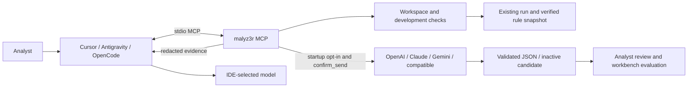

# MCP integration for analyst IDEs

## Install and start

Use Python 3.11 or newer for the optional MCP server (core commands support 3.10+):

```console
python -m pip install -c constraints.txt ".[mcp]"
python -m malware_scanner.mcp_server --workspace /absolute/path/to/malyz3r
```

The server uses pinned official SDK `mcp==2.3.0`, communicates over stdio, and waits
for an MCP client. An idle terminal is normal. Do not send regular shell input;
connect through your IDE. There is no listening network port. The installed
`malyz3r-mcp` entry point is equivalent. Use an absolute interpreter path in IDE
configuration so that the intended environment is selected regardless of IDE cwd.

## Cursor and Antigravity

Merge this server entry with existing entries; replace both example paths.
On Windows use forward slashes as below or escaped backslashes in JSON.

```json
{
  "mcpServers": {
    "malyz3r": {
      "command": "C:/path/to/malyz3r/.venv/Scripts/python.exe",
      "args": ["-m", "malware_scanner.mcp_server", "--workspace", "C:/path/to/malyz3r"]
    }
  }
}


For Cursor, use project `.cursor/mcp.json` or its global MCP configuration.
For Antigravity, open **Manage MCP Servers / View raw config** and add the entry
in its `mcp_config.json`; location varies by IDE/CLI version. Do not overwrite
other servers. Restart/reload the server and check that `development_evidence`
appears in the IDE tool list.

## OpenCode

Merge into `opencode.json`:

```json
{
  "$schema": "https://opencode.ai/config.json",
  "mcp": {
    "malyz3r": {
      "type": "local",
      "command": ["C:/path/to/malyz3r/.venv/Scripts/python.exe", "-m", "malware_scanner.mcp_server", "--workspace", "C:/path/to/malyz3r"],
      "enabled": true
    }
  }
}
```

On Linux/macOS replace the executable with `/path/to/malyz3r/.venv/bin/python`.
The package must be installed in that environment; the IDE working directory is
not used to find application code.

## Tools and workflow

`development_evidence(run_directory, include_rule_source=false)` reads an existing
complete workbench run relative to the configured workspace. It returns per-rule
metrics, up to 40 selected cases, report SHA-256 and analyst instructions. It does
not return sample bytes, sample paths, hashes or the private evidence map. Rule
identifiers may reveal filenames. Rule source is optional, hash-verified, and can
contain sensitive strings/comments. Held-out/mixed/unspecified splits are rejected.

Example IDE prompt:

> Use malyz3r development_evidence on runs/MY_DEVELOPMENT_RUN. Explain the false
> positives and missing evidence. Cite the supplied sample IDs. Do not activate or
> edit rules. Ask before including rule source.

The default server makes no provider request and needs no API key. **Your IDE may
send returned evidence to its configured model**; its retention and permissions
apply. Server-local privacy controls cannot control the IDE's other tools. Treat
report/rule text as untrusted data, including any instructions embedded in it.

To enable a separate provider request, add startup arguments such as:

```console
malyz3r-mcp --workspace /path/to/malyz3r --allow-network --provider anthropic --model YOUR_MODEL_ID
```

The provider key must be in the server's inherited environment. Do not commit
keys in IDE configs. `--base-url` is supported for `openai-compatible`. Provider,
model and endpoint are configured at startup, not supplied by the model's tool call.
This registers `request_advice(run_directory, confirm_send=false,
include_rule_source=false)`. It requires `confirm_send=true`, may incur charges,
and creates a unique `assistant-runs/ID` with request, private evidence map, status,
advice and any inactive `candidate.yar.txt`. It returns the relative output path.
The confirmation argument is an application gate, not proof of human approval:
retain the IDE's own approval controls for network tools.

No tool executes samples, runs arbitrary commands, modifies labels/policies,
activates rules, or scans a new corpus. Use the workbench CLI for evaluation and
comparison after analyst review. Paths resolve within the configured workspace,
including symlinks/junctions; concurrent hostile filesystem changes are outside
this local single-user service's isolation guarantees. Do not expose it as a
multi-tenant service.



## Verification and limitations

Automated tests launch a real stdio server subprocess, discover tools, retrieve
fixture evidence, and reject path traversal. In-memory MCP tests verify the
network tool gate. Provider HTTP responses are simulated to verify request shapes,
credential separation, completion validation and artifact behavior. These tests
are not live paid provider calls, nor interactive certification of each named IDE.
The SDK handles protocol negotiation. Install the supported MCP extra before
running `python -m unittest discover -s tests -v`; otherwise MCP tests are skipped.

Official configuration references:
[Cursor](https://cursor.com/docs/mcp),
[Antigravity](https://antigravity.google/docs/mcp),
[OpenCode](https://opencode.ai/docs/mcp-servers/),
[Python MCP SDK](https://github.com/modelcontextprotocol/python-sdk).
