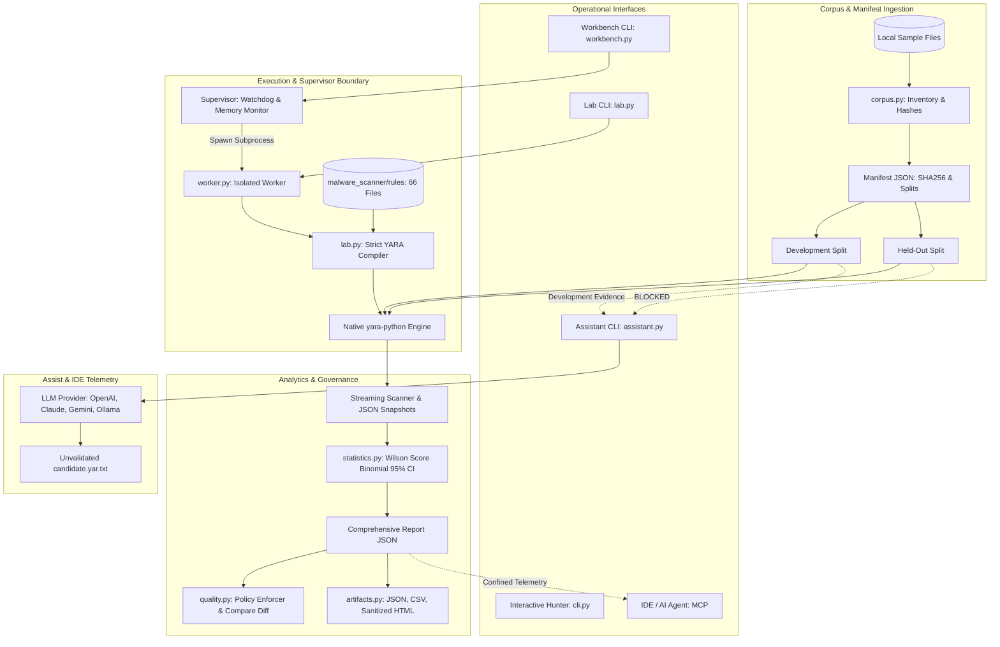

# malyz3r — YARA Rule Engineering Workbench & Threat Analysis Platform

[](tests/)
[](malware_scanner/rules/)
[](MCP.md)
[](pyproject.toml)
[](pyproject.toml)
[](LICENSE)

**malyz3r** is an open-source detection engineering framework and static analysis workbench for **threat hunters**, **security researchers**, and **DFIR analysts**. It provides a rigorous, test-driven methodology for static YARA rule authoring, labeled-corpus regression evaluation, statistical confidence scoring (Wilson score intervals), AI-assisted rule refinement, and IDE telemetry via the Model Context Protocol (MCP).

---

## Table of Contents

- [Honest Disclaimers & Operational Boundaries](#honest-disclaimers--operational-boundaries)
- [System Architecture & Boundaries](#system-architecture--boundaries)
- [Comprehensive Threat Detection Catalog (66 Files / 69 Detectors)](#comprehensive-threat-detection-catalog-66-files--69-detectors)
- [Installation & Environment Setup](#installation--environment-setup)
- [Docker Packaging & Corpus Persistence](#docker-packaging--corpus-persistence)
- [Executable Interfaces & Operational Workflows](#executable-interfaces--operational-workflows)
  - [1. Operational Workbench (`malyz3r-workbench`)](#1-operational-workbench-malyz3r-workbench)
  - [2. Direct Evaluation Engine (`malyz3r-lab`)](#2-direct-evaluation-engine-malyz3r-lab)
  - [3. Multi-Provider AI Assistant (`malyz3r-assist`)](#3-multi-provider-ai-assistant-malyz3r-assist)
  - [4. MCP IDE Integration (`malyz3r-mcp`)](#4-fastmcp-ide-integration-malyz3r-mcp)
  - [5. Interactive Threat Hunting CLI (`malyz3r`)](#5-interactive-threat-hunting-cli-malyz3r)
- [Detection Engineering Lifecycle (7 Phases)](#detection-engineering-lifecycle-7-phases)
- [Manifest Schema, Split Isolation & Data Integrity](#manifest-schema-split-isolation--data-integrity)
- [Statistical Honesty: Wilson Score Confidence Intervals](#statistical-honesty-wilson-score-confidence-intervals)
- [Quality Gate Policies & Production Promotion](#quality-gate-policies--production-promotion)
- [Threat Model & Security Considerations](#threat-model--security-considerations)
- [Automated Testing & CI/CD Verification](#automated-testing--cicd-verification)
- [Repository Structure](#repository-structure)
- [License & Attribution](#license--attribution)

---

## Honest Disclaimers & Operational Boundaries

> [!IMPORTANT]
> **Project Status: Single-analyst evaluation workbench and research harness. Read the following operational realities before deploying or evaluating this software.**

1. **Not an Antivirus, EDR, or Real-Time Shield**:
   - `malyz3r` is an on-demand, batch-oriented static rule evaluator.
   - It does **not** install a kernel-level file-system minifilter, intercept live system calls, monitor network packets, or terminate running malicious processes in real time.
2. **Not a Dynamic Sandbox or Detonation Chamber**:
   - Files are parsed strictly as byte buffers. `malyz3r` does not execute binaries, unpack runtime payloads, emulate CPU instructions, or inspect behavioral dynamic API call traces.
   - Live, weaponized malware samples **must be isolated in an air-gapped or dedicated analysis virtual machine**.
3. **Static Rule Limitations (Packers, Crypters & Obfuscation)**:
   - YARA operates on static byte sequences, strings, and PE metadata. If a binary is packed with UPX, Themida, VMProtect, or a custom polymorphic runtime crypter, plain-text string signatures will fail until the binary is unpacked.
   - Detection signatures based on ephemeral indicators (e.g., hardcoded C2 domains, IP addresses, or transient staging paths) degrade rapidly across threat actor campaigns.
4. **Worker Process Boundary != OS Sandbox**:
   - The workbench supervisor executes rule evaluations inside a child Python subprocess (`malware_scanner/worker.py`) guarded by an execution timer (`--wall-seconds`) and resident memory cap (`--memory-mb`).
   - This subprocess boundary catches engine hangs, regex backtracking stalls, and out-of-memory errors. **It is not an operating system security boundary** (such as a seccomp jail or Firecracker microVM) and does not protect against native kernel vulnerabilities or parsing exploits targeting C-libraries.
5. **Heuristic Candidate Rules, Not Certified Threat Feeds**:
   - The 66 bundled YARA rule files are open-source detection engineering heuristics curated from public threat reports, malware analyses, and reverse engineering research.
   - They have not been certified for commercial production environments without local tuning. Rules can and will generate false positives if applied to arbitrary enterprise software without proper allowlisting.
6. **Analysts Establish Ground Truth**:
   - `malyz3r` calculates detection metrics (Precision, Recall, False Positive Rate) strictly against analyst-provided manifests. It has no independent awareness of true malware status. Inaccurate ground truth manifests will produce deceptive metrics.
7. **Synthetic Fixtures vs. Wild Corpora**:
   - The test fixtures in [`samples/lab/`](samples/lab/) are harmless synthetic text files and minimal PE structures crafted for deterministic CI regression testing.
   - Achieving 100% precision and recall on synthetic fixtures **does not imply high real-world efficacy against evolving malware in the wild**.
8. **AI Assistant Guardrails**:
   - Large Language Models frequently hallucinate invalid YARA syntax, regex constructs, and condition logic.
   - `malyz3r-assist` outputs non-executable draft suggestions (`candidate.yar.txt`). It never automatically promotes or enables candidate rules. Human review and corpus re-evaluation are mandatory.
9. **VirusTotal OPSEC & Rate Limits**:
   - VirusTotal API v3 integration in the interactive CLI requires a valid analyst API key.
   - Free-tier accounts are restricted to 4 requests/minute.
   - **OPSEC Warning**: Querying or submitting proprietary hashes, red-team payloads, or sensitive corporate incident data to public multi-scanner engines may expose confidential engagement artifacts to third parties.

---

## System Architecture & Boundaries

`malyz3r` cleanly separates untrusted sample ingestion, supervised worker execution, statistical metrics calculation, quality policy enforcement, and reporting:



---

## Comprehensive Threat Detection Catalog (66 Files / 69 Detectors)

The detection catalog in [`malware_scanner/rules/`](malware_scanner/rules/) covers **66 rule files** containing **69 discrete YARA detectors** mapped to known threat families, attack techniques, and MITRE ATT&CK tactics:

| Category | Files | Threat Families & Detectors | MITRE ATT&CK Mapping | Detection Mechanism |
| :--- | :---: | :--- | :--- | :--- |
| **Advanced Persistent Threats (APT)** | 8 | • APT28 (Sofacy / Fancy Bear CHOPSTICK/SPLM)<br>• APT29 (Cozy Bear / Nobelium / SolarWinds)<br>• Lazarus Group (HIDDEN COBRA / BlueNoroff)<br>• MuddyWater (Seed / POWERSTATS)<br>• OilRig (Helix Kitten / BONDUPDATER)<br>• Sandworm (BlackEnergy / Industroyer)<br>• Turla (Snake / Uroburos)<br>• Winnti Group (APT41 / Barlaiy) | T1071 (Standard Application Layer Protocol)<br>T1059 (Command & Scripting)<br>T1105 (Ingress Tool Transfer)<br>T1027 (Obfuscated Files) | Characteristic C2 URI patterns, registry persistence keys, unique XOR decryption routines, and hardcoded mutex strings. |
| **Ransomware** | 12 | • Babuk Locker (ESXi / Win)<br>• BlackCat (ALPHV Rust-based)<br>• Clop (TA505 / FIN11)<br>• Conti (Wizard Spider v1-v3)<br>• DarkSide / BlackMatter<br>• Hive (Go/Rust variants)<br>• LockBit 3.0 (LockBit Black)<br>• Phobos / Elrond / 8base<br>• Play (PlayCrypt)<br>• REvil (Sodinokibi)<br>• Rhysida<br>• WannaCry (WanaCrypt0r 2.0) | T1486 (Data Encrypted for Impact)<br>T1490 (Inhibit System Recovery)<br>T1489 (Service Stop) | VSS deletion commands (`vssadmin delete shadows`), ransom note templates, encryption marker footers, and cryptographic API imports (`BCryptGenRandom`, `CryptEncrypt`). |
| **Infostealers** | 9 | • AgentTesla (.NET Keylogger)<br>• Ducktail (Facebook Business Stealer)<br>• FormBook / XLoader<br>• LummaC2 (Lumma Stealer C2)<br>• Meduza Stealer<br>• Raccoon Stealer (v1 & v2)<br>• RedLine Stealer<br>• Stealc (C-based Stealer)<br>• Vidar Stealer | T1005 (Data from Local System)<br>T1555 (Credentials from Password Stores)<br>T1539 (Steal Web Session Cookie)<br>T1115 (Clipboard Data) | Browser profile paths (`Login Data`, `Cookies`), crypto wallet directory targets, Telegram session paths, and base64 C2 exfiltration patterns. |
| **Remote Access Trojans (RAT)** | 9 | • AsyncRAT (.NET open-source RAT)<br>• Cobalt Strike Beacon (Malleable C2 & Shellcode)<br>• Havoc Demon C2<br>• IcedID (BokBot Banking RAT)<br>• njRAT (Bladabindi)<br>• QuasarRAT (.NET RAT)<br>• Remcos RAT (BreakingSecurity)<br>• ShadowPad (APT41 shared tool)<br>• Sliver C2 (BishopFox Go framework) | T1219 (Remote Access Software)<br>T1059.001 (PowerShell)<br>T1056.001 (Keylogging)<br>T1095 (Non-Application Layer Protocol) | Default C2 TLS certificates, protocol handshakes, reflective loader stubs, beacon configuration blocks, and keylogger hooks. |
| **WebShells** | 6 | • ASPX Spy<br>• b374k (PHP WebShell)<br>• China Chopper (Minimal 1-liner & Client)<br>• Godzilla Memory Shell<br>• Weevely (Steganographic PHP WebShell)<br>• WSO (Web Shell by Orb) | T1505.003 (Server Software Component: Web Shell)<br>T1059.004 (Unix Shell)<br>T1059.006 (Python) | PHP `eval(base64_decode(...))`, ASPX `.NET` compilation directives, JSP reflective classloader invocations, and command execution primitives (`system`, `passthru`, `proc_open`). |
| **Botnets & Loaders** | 6 | • Emotet (HeLoader / Geodo)<br>• Gafgyt / Qbot (BASHLITE IoT)<br>• Mirai (Telnet brute-force IoT)<br>• Mozi (P2P IoT Botnet)<br>• QakBot (Pinkslipbot / Qbot)<br>• TrickBot (Anchor / BazarLoader) | T1584.005 (Botnet)<br>T1110.001 (Password Guessing)<br>T1498 (Network Denial of Service)<br>T1105 (Ingress Tool Transfer) | Telnet credential dictionaries, IoT cross-compilation strings (MIPS/ARM), P2P DHT routing signatures, and multi-stage DLL unpacker exports. |
| **Destructive Wipers** | 4 | • CaddyWiper<br>• HermeticWiper (FoxBlade)<br>• NotPetya (EternalBlue wiper)<br>• Shamoon (Disttrack wiper) | T1561.001 (Disk Content Wipe)<br>T1561.002 (Disk Structure Wipe)<br>T1490 (Inhibit System Recovery) | Raw disk handles (`\\.\PhysicalDrive0`), MBR overwriting loops, partition table zeroing, and SCSI/IDE miniport driver manipulation. |
| **Exploitation & Injections** | 4 | • EternalBlue (MS17-010 SMBv1 exploit)<br>• Log4Shell (CVE-2021-44228 JNDI injection)<br>• Process Hollowing (`NtUnmapViewOfSection`)<br>• Reflective DLL Injection (`ReflectiveLoader`) | T1210 (Exploitation of Remote Services)<br>T1190 (Exploit Public-Facing Application)<br>T1055.012 (Process Hollowing)<br>T1055.001 (Dynamic-link Library Injection) | SMBv1 FEA list buffer overflow patterns, `${jndi:ldap://}` string patterns, API injection sequences (`VirtualAllocEx` -> `WriteProcessMemory` -> `SetThreadContext`), and MZ PE search loops. |
| **Miners & Rootkits** | 2 | • XMRig Stratum Cryptominer<br>• Kernel Hooking Rootkits (Win/Linux) | T1496 (Resource Hijacking)<br>T1014 (Rootkit)<br>T1068 (Exploitation for Privilege Escalation) | Stratum mining protocol commands (`mining.subscribe`, `mining.authorize`), Monero pool endpoints, `/dev/kmem` manipulation, and SSDT hook signatures. |
| **Baseline Heuristics** | 6 | • Generic Trojans<br>• Generic Ransomware indicators<br>• Generic Worm propagation<br>• Phishing login scripts<br>• Static PE header anomalies<br>• Advanced heuristic behavioral markers | T1204 (User Execution)<br>T1566 (Phishing)<br>T1027 (Obfuscated Files)<br>T1129 (Shared Modules) | High PE section entropy (> 7.2), suspicious section names (`.upx`, `.vmp`, `.themida`), suspicious import hashes, and phishing form actions (`action="http..."`). |

---

## Installation & Environment Setup

### System Prerequisites

- **Python**: 3.10, 3.11, 3.12, or 3.13 (64-bit).
- **Windows**: Microsoft Visual C++ 2015-2022 Redistributable (included by default on modern Windows).
- **Linux**: Python development headers and OpenSSL development libraries:
  ```bash
  sudo apt-get update && sudo apt-get install -y build-essential libssl-dev python3-dev
  ```

### Installation Steps

```bash
# 1. Clone repository
git clone https://github.com/gl1tch0x1/malyz3r.git
cd malyz3r

# 2. Create isolated virtual environment
python -m venv .venv

# Activate on Linux/macOS:
source .venv/bin/activate
# Activate on Windows PowerShell:
.\.venv\Scripts\Activate.ps1

# 3. Install dependencies pinned against strict constraints
python -m pip install -c constraints.txt .

# 4. (Optional) Install MCP IDE telemetry server (Python 3.11+ required)
python -m pip install ".[mcp]"
```

---

## Docker Packaging & Corpus Persistence

The container packages the application and versioned research metadata. Private corpora stay outside the build context and can be mounted at runtime:
- Complete engine, dependencies, and CLI entry points.
- 66 compiled YARA rule files (`/app/malware_scanner/rules`).
- Labeled sample datasets (`/app/datasets`).
- An empty mount point for local corpora (`/app/local-corpus`).
- Regression fixtures (`/app/samples/lab`).

### Building and Executing via Docker

```bash
# Build the analyst container image
docker build -t malyz3r:latest .

# Run the complete automated test suite (72 tests plus linters; hosted CI is separate)
docker run --rm malyz3r:latest python tests/run_validation.py

# Run a supervised workbench evaluation, persisting reports to host machine
docker run --rm -v "$(pwd)/runs:/app/runs" malyz3r:latest \
  malyz3r-workbench run samples/lab/manifest.json --rules malware_scanner/rules --runs-dir runs/container-run-01 \
  --wall-seconds 120 --memory-mb 512
```

---

## Executable Interfaces & Operational Workflows

`malyz3r` exposes five dedicated CLI entry points:

### 1. Operational Workbench (`malyz3r-workbench`)

The workbench manages corpus manifests, executes supervised test jobs with watchdog timers, inspects run telemetry, enforces quality gates, and compares candidate revisions against baselines:

```
malyz3r-workbench {inventory,merge,run,inspect,compare} [options]
```

#### Inventorying a Sample Directory
Scans a folder, records file sizes, computes SHA256 hashes, and outputs an analyst-labeled manifest:

```bash
malyz3r-workbench inventory /path/to/ransomware --provenance "Incident-2026-Q1" \
  --label target \
  --expected-rule "ransom_lockbit.yar:Ransomware_LockBit3" \
  --split development \
  --output manifest_lockbit_dev.json
```

#### Merging Disparate Manifests
Combines multiple manifests into a unified test manifest while strictly validating schema compliance and deduplicating identical file hashes:

```bash
malyz3r-workbench merge manifest_lockbit_dev.json manifest_benign_heldout.json \
  --output manifest_evaluation_suite.json
```

#### Executing a Supervised Evaluation Run
Spawns an isolated worker subprocess with strict wall-clock and RSS memory limits:

```bash
malyz3r-workbench run manifest_evaluation_suite.json malware_scanner/rules runs/run-2026-01 \
  --timeout 10 \
  --max-bytes 67108864 \
  --wall-seconds 180 \
  --memory-mb 512 \
  --policy policies/research.json
```

*Output summary emitted on stdout:*
```json
{
  "run_directory": "runs/run-2026-01",
  "exit_code": 0,
  "complete": true,
  "samples_evaluated": 120,
  "errors": 0,
  "policy_passed": true,
  "duration_seconds": 2.451
}
```

#### Inspecting Run Status
Displays the raw `status.json` artifact for a completed or aborted run:

```bash
malyz3r-workbench inspect runs/run-2026-01
```

#### Comparing Baseline vs. Candidate Rules (Regression Diff)
Compares two evaluation runs to detect newly introduced False Positives (FPs) or dropped True Positives (FN regressions):

```bash
malyz3r-workbench compare runs/baseline-rules runs/candidate-rules --output comparison.json
```

---

### 2. Direct Evaluation Engine (`malyz3r-lab`)

A streamlined, single-process evaluator that executes without the external supervisor process. Ideal for rapid CI/CD smoke tests and embedded scripts:

```bash
# Evaluate manifest against rules with strict exit codes (exits 3 on any FP or FN)
python -m malware_scanner.lab samples/lab/manifest.json \
  --rules malware_scanner/rules \
  --strict \
  --timeout 10 \
  --max-bytes 67108864 \
  --output report.json
```

---

### 3. Multi-Provider AI Assistant (`malyz3r-assist`)

Leverages Large Language Models to analyze development run misclassifications and suggest candidate rule refinements:

```
malyz3r-assist [--provider {openai,anthropic,gemini,openai-compatible}]
               [--base-url BASE_URL]
               [--model MODEL]
               [--send]
               [--include-rule-source]
               run_directory --output OUTPUT_DIR
```

#### Safe Offline Preview Mode (Zero Network Calls)
Generates an anonymized, sanitized JSON payload for human audit before sending anything upstream:

```bash
malyz3r-assist runs/run-2026-01 preview-output/ --model gpt-4o
```

#### Sending Sanitized Queries to OpenAI, Anthropic Claude, or Google Gemini
```bash
# OpenAI GPT-4o
export OPENAI_API_KEY="sk-..."
malyz3r-assist runs/run-2026-01 advice-openai/ --model gpt-4o --send --include-rule-source

# Anthropic Claude 3.5 Sonnet
export ANTHROPIC_API_KEY="sk-ant-..."
malyz3r-assist runs/run-2026-01 advice-claude/ --provider anthropic --model claude-3-5-sonnet-20241022 --send --include-rule-source

# Google Gemini 1.5 Pro
export GEMINI_API_KEY="..."
malyz3r-assist runs/run-2026-01 advice-gemini/ --provider gemini --model gemini-1.5-pro --send --include-rule-source

# Local Ollama or vLLM instance (Fully offline LLM)
malyz3r-assist runs/run-2026-01 advice-local/ --provider openai-compatible \
  --base-url "http://localhost:11434/v1" --model llama3 --send --include-rule-source
```

> [!NOTE]
> `malyz3r-assist` strictly validates that:
> 1. No raw sample bytes, file paths, or client identifiers leave the local machine.
> 2. The run contains zero `held-out` samples (refuses execution to prevent data leakage).
> 3. Candidate rules are written to `candidate.yar.txt` as unvalidated text and never deployed automatically.

---

### 4. MCP IDE Integration (`malyz3r-mcp`)

Implements the Model Context Protocol (v1.26+) over stdio. AI-powered IDEs (Cursor, Antigravity, OpenCode, Claude Desktop) can inspect runs and request advice securely within the workspace.

#### Server Configuration (`cursor.json` / `claude_desktop_config.json`)

```json
{
  "mcpServers": {
    "malyz3r": {
      "command": "python",
      "args": [
        "-m", "malware_scanner.mcp_server",
        "--workspace", "C:/Users/Acer/Documents/ChatGPT/YARA"
      ]
    }
  }
}
```

#### Exposed MCP Tools

1. **`development_evidence`** (`readOnlyHint=true`, `openWorldHint=false`):
   - Reads a completed development run directory confined to the workspace.
   - Rejects runs containing `held-out` validation data.
   - Strips sample paths and raw bytes, returning structured misclassification metrics and rule text.
2. **`request_advice`** (`readOnlyHint=false`, `openWorldHint=true`):
   - Only enabled when the server is launched with `--allow-network --model <ID>`.
   - Requires explicit `confirm_send=true`.
   - Submits sanitized development evidence to the configured provider and saves unvalidated advice to `assistant-runs/<uuid>/`.

---

### 5. Interactive Threat Hunting CLI (`malyz3r`)

An interactive terminal interface for ad-hoc file scanning, memory hunting, and VirusTotal hash lookup:

```bash
python run_scanner.py
# or
malyz3r
```

- **Scan File/Directory**: Evaluates target paths against the 66 bundled YARA rule files.
- **Process Memory Scan**: Inspects active virtual memory of running processes for in-memory payloads.
- **Hexdump / String Inspection**: Previews strings and hex representations of suspicious offsets.
- **VirusTotal v3 Hash Lookup**: Queries file SHA256 hashes against VirusTotal (requires `VT_API_KEY` environment variable).

---

## Detection Engineering Lifecycle (7 Phases)

Detection engineering requires reproducible measurement. `malyz3r` enforces a disciplined 7-phase lifecycle:

```
[Phase 1: Ingestion]  -->  [Phase 2: Split Assignment]  -->  [Phase 3: Baseline Evaluation]
                                   |                                     |
                                   v                                     v
                        [Phase 4: Rule Refinement]  <--  [Optional LLM Assistance]
                                   |
                                   v
                        [Phase 5: Candidate Evaluation]
                                   |
                                   v
                        [Phase 6: Regression Diff]
                                   |
                                   v
                        [Phase 7: Policy Gate (Pass / Reject)]
```

1. **Phase 1: Ingestion & Inventorying**:
   - Analyst scans incoming samples with `malyz3r-workbench inventory`.
   - Tool computes SHA256 digests and file sizes, deduplicating identical binaries.
2. **Phase 2: Split Assignment**:
   - Samples are explicitly labeled as `development` (used for iterative rule authoring) or `held-out` (strictly reserved for unbiased quality gating).
3. **Phase 3: Baseline Evaluation**:
   - Current rules are evaluated against the manifest to establish baseline True Positives, False Positives, and False Negatives.
4. **Phase 4: Rule Refinement**:
   - Detection engineers author or tune YARA rules in `malware_scanner/rules/`.
   - Optionally invoke `malyz3r-assist` to review development misclassifications.
5. **Phase 5: Candidate Evaluation**:
   - Re-evaluate candidate rules against the identical dataset manifest under supervisor control.
6. **Phase 6: Regression Diffing**:
   - Run `malyz3r-workbench compare` to identify newly introduced false positives or dropped detections.
7. **Phase 7: Policy Gate**:
   - Check candidate metrics against an explicit quality policy (e.g., `min_recall_lower95: 0.90`, `max_benign_fpr: 0.00`). If passed, promote to production.

---

## Manifest Schema, Split Isolation & Data Integrity

Manifest files establish analyst-asserted ground truth. Every sample entry specifies its path, ground truth label, expected rules, split partition, and SHA256 hash:

```json
{
  "name": "apt28-and-ransomware-corpus-2026",
  "kind": "empirical",
  "samples": [
    {
      "path": "samples/apt28_dropper.bin",
      "label": "target",
      "expected_rules": [
        "apt_fancybear_sofaciy.yar:APT28_Sofacy_CHOPSTICK"
      ],
      "split": "development",
      "provenance": "CISA-Alert-AA23-180A",
      "family": "Sofacy",
      "sha256": "450dd0ace070e08635b19c9179150da4f81e30ea5c77538dbc880ad86863db37"
    },
    {
      "path": "samples/clean_system32_calc.exe",
      "label": "benign",
      "expected_rules": [],
      "split": "held-out",
      "provenance": "Windows-11-23H2-Clean-Install",
      "sha256": "a9538c5f4654a0752920c45015febcc0e37fb83f32c73e26025747d33d10b6af"
    }
  ]
}
```

### Data Split Rules:
- **`development`**: Permitted for rule tuning, iterative testing, and LLM assistant evidence generation.
- **`held-out`**: Never exposed to the LLM assistant or tuning loops. Reserved exclusively for final unbiased policy verification.
- **`unspecified`**: Evaluated normally, but rejected by policies that require split verification (`require_held_out: true`).

---

## Statistical Honesty: Wilson Score Confidence Intervals

A frequent trap in detection engineering is evaluating a rule against a small corpus (e.g., 8 positive samples) and claiming "100% precision and 100% recall." In reality, small samples carry wide statistical uncertainty.

`malyz3r` automatically computes **two-sided 95% Wilson score binomial confidence intervals** for all metric ratios (Recall, Benign False Positive Rate):

$$\hat{p} = \frac{k + \frac{z^2}{2}}{n + z^2} \pm \frac{z}{n + z^2}\sqrt{\frac{k(n-k)}{n} + \frac{z^2}{4}}$$

*(where $k$ is successes, $n$ is trials, and $z = 1.96$ for a 95% confidence interval)*

### Illustrative Comparison:
- **10/10 detections on small corpus**: Point Recall = 100%, but 95% Confidence Interval = **[72.2%, 100.0%]**.
- **100/100 detections on larger corpus**: Point Recall = 100%, 95% Confidence Interval = **[96.3%, 100.0%]**.

`malyz3r` reports both the point estimate and the interval bounds (`recall_ci95`, `benign_fpr_ci95`), enabling quality policies to enforce lower-bound confidence thresholds (`min_recall_lower95`).

---

## Quality Gate Policies & Production Promotion

Quality policies define machine-enforceable rules that candidate YARA rule sets must pass before deployment:

### Example Policy (`policies/production.json`):
```json
{
  "min_recall": 0.95,
  "min_recall_lower95": 0.85,
  "max_benign_fpr": 0.00,
  "max_benign_fpr_upper95": 0.02,
  "min_target_samples": 20,
  "min_benign_samples": 100,
  "max_unknown_labels": 0,
  "require_held_out": true,
  "reject_synthetic": true,
  "rules": [
    "apt_fancybear_sofaciy.yar:APT28_Sofacy_CHOPSTICK",
    "ransom_lockbit.yar:Ransomware_LockBit3"
  ]
}
```

### Supported Policy Fields:
- **`min_recall`**: Minimum acceptable point recall on target samples ($[0.0, 1.0]$).
- **`min_recall_lower95`**: Minimum acceptable 95% Wilson confidence lower bound ($[0.0, 1.0]$).
- **`max_benign_fpr`**: Maximum acceptable point false-positive rate on benign samples ($[0.0, 1.0]$).
- **`max_benign_fpr_upper95`**: Maximum acceptable 95% Wilson confidence upper bound ($[0.0, 1.0]$).
- **`min_target_samples`**: Minimum required target samples in evaluation manifest.
- **`min_benign_samples`**: Minimum required benign samples in evaluation manifest.
- **`max_unknown_labels`**: Maximum permitted unlabeled or unknown samples.
- **`require_held_out`**: Boolean requiring that the evaluation contains held-out validation data.
- **`reject_synthetic`**: Boolean rejecting synthetic test manifests for production promotion.
- **`rules`**: Specific subset of rule IDs to evaluate.

---

## Threat Model & Security Considerations

1. **Passive Static Ingestion**:
   - Files are opened in binary read mode (`open(..., "rb")`). They are never executed, loaded via `LoadLibrary`, or parsed with dynamic code evaluators.
2. **Subprocess Resource Bounds**:
   - The workbench supervisor monitors process memory (`psutil.Process().memory_info().rss`) and process execution time. If a rule causes catastrophic backtracking or memory consumption exceeding limits, the child process is terminated immediately.
3. **Data Privacy & Prompt Sanitization**:
   - `malyz3r-assist` anonymizes data before transmission: sample paths, file names, internal directory hierarchies, and raw binary bytes are never included in LLM prompts.
   - LLM queries are blocked if held-out test splits are detected.
4. **Export Sanitization**:
   - HTML reports sanitize and escape user-controlled strings to prevent stored Cross-Site Scripting (XSS).
   - CSV reports prepend a single quote (`'`) to cells starting with `=`, `+`, `-`, or `@` to neutralize spreadsheet formula injection attacks.

---

## Automated Testing & CI/CD Verification

The repository contains a complete automated test suite of **71 unit tests**:

```bash
# 1. Run all unit tests
python -m unittest discover -s tests -v

# 2. Check formatting and linting with Ruff
python -m ruff check
python -m ruff format --check

# 3. Execute the full end-to-end CI validation suite
python tests/run_validation.py

# 4. Verify clean wheel build and installation
python tests/smoke_install.py
```

### Static Type Safety
- Configured for **Pyright / Pylance** static analysis (`pyproject.toml`).
- Native C-extension type stubs defined in [`typings/yara.pyi`](typings/yara.pyi).
- Pure single-inheritance test architecture resolving `TestCase.run` namespace collisions.

---

## Repository Structure

```
.
├── malware_scanner/          # Core Python package
│   ├── rules/                # 66 candidate YARA rule files (69 detectors)
│   ├── __init__.py           # Package version definition
│   ├── artifacts.py          # Report export (JSON, CSV, sanitized HTML)
│   ├── assistant.py          # Multi-provider LLM assistant (OpenAI, Claude, Gemini, Ollama)
│   ├── benchmark.py          # Benchmark harness and performance matrix
│   ├── cli.py                # Interactive threat hunting terminal CLI
│   ├── corpus.py             # Manifest inventory, merge, and verification
│   ├── lab.py                # Strict YARA compiler and evaluation engine
│   ├── mcp_server.py         # MCP stdio server for IDE integration
│   ├── providers.py          # API client adapters for LLM providers
│   ├── quality.py            # Quality policy enforcement and regression diffs
│   ├── scanner.py            # Core file and memory scanning engine
│   ├── statistics.py         # Wilson score binomial confidence interval calculator
│   ├── workbench.py          # Subprocess supervisor and analyst workflow CLI
│   └── worker.py             # Supervised child process worker
├── datasets/                 # Packaged evaluation and calibration datasets
├── local-corpus/             # Local sample corpora
├── samples/lab/              # Harmless synthetic test fixtures and manifests
├── scripts/                  # Linux cron automation and rule generation scripts
├── tests/                    # 71 comprehensive unit tests and CI runner
├── typings/                  # Static type stubs for native extensions (yara.pyi)
├── Dockerfile                # Production Docker container definition
├── Dockerfile.validation     # Pinned CI validation container
├── pyproject.toml            # Project packaging metadata, Ruff and Pyright config
├── constraints.txt           # Pinned dependency constraints
├── MCP.md                    # Detailed Model Context Protocol guide
└── README.md                 # This documentation
```

---

## License & Attribution

Distributed under the **MIT License**. See [LICENSE](LICENSE) for details.

Original project created by [gl1tch0x1](https://github.com/gl1tch0x1). Enhanced and maintained by detection engineering and threat research teams.
