# malyz3r — YARA Rule Engineering Workbench & Threat Detection Assurance Platform

<p align="center">
  <a href="https://deepwiki.com/gl1tch0x1/malyz3r"></a>
  <a href="tests/"></a>
  <a href="malware_scanner/rules/"></a>
  <a href="MCP.md"></a>
  <a href="pyproject.toml"></a>
  <a href="pyproject.toml"></a>
  <a href="pyrightconfig.json"></a>
  <a href="LICENSE"></a>
</p>

---

## Executive Summary

**malyz3r** is an enterprise-grade detection engineering framework, empirical static analysis workbench, and local detection assurance platform designed specifically for **threat hunters**, **security researchers**, and **DFIR analysts**. 

Traditional YARA rule deployment frequently suffers from critical operational failure modes: signatures written against single samples without regression testing, deceptive "100% precision" claims on statistically underpowered datasets, unmonitored regex backtracking hangs, and accidental data exposure when leveraging LLMs for rule authoring.

`malyz3r` treats detection engineering as an empirical, test-driven discipline:
- **Local Detection Assurance Workspace**: An authenticated, zero-external-dependency web console providing real-time evaluation analytics, an interactive force-directed relationship graph, and machine-enforceable release gates.
- **Statistical Rigor**: Replaces point estimates with **two-sided 95% Wilson score binomial confidence intervals** on all precision, recall, and false positive metrics.
- **Subprocess Isolation & Supervision**: Executes YARA evaluations in isolated worker processes guarded by wall-clock watchdog timers and resident memory (RSS) caps.
- **Split Isolation & Manifest Governance**: Enforces strict separation between `development` samples (used for iterative tuning) and `held-out` samples (quarantined strictly for release gating).
- **FastMCP 2.3.0 IDE Server**: Native Model Context Protocol server exposing sanitized workspace telemetry to AI-assisted coding environments (Cursor, Claude Desktop, Antigravity) with zero raw binary exfiltration.
- **Curated Threat Catalog**: 66 battle-tested YARA rule files housing 69 discrete detectors mapped against MITRE ATT&CK tactics, nation-state APTs, ransomware, wipers, and stealers.

---

## Table of Contents

- [The Detection Engineering Problem](#the-detection-engineering-problem)
- [System Architecture & Isolation Boundaries](#system-architecture--isolation-boundaries)
- [Local Detection Assurance Workspace (`malyz3r-web`)](#local-detection-assurance-workspace-malyz3r-web)
- [Evidence Model & Interactive Detection Map](#evidence-model--interactive-detection-map)
- [Supervisor Execution Protocol & Worker Boundary](#supervisor-execution-protocol--worker-boundary)
- [Sample Classification & Statistical Rigor](#sample-classification--statistical-rigor)
- [Quality Gate Policies & Release Decisions](#quality-gate-policies--release-decisions)
- [The 7-Phase Detection Engineering Lifecycle](#the-7-phase-detection-engineering-lifecycle)
- [Comprehensive Threat Detection Catalog (66 Files / 69 Detectors)](#comprehensive-threat-detection-catalog-66-files--69-detectors)
- [Corpus Manifest Schema & Split Governance](#corpus-manifest-schema--split-governance)
- [Multi-Provider AI Assistant (`malyz3r-assist`)](#multi-provider-ai-assistant-malyz3r-assist)
- [FastMCP IDE Integration (`malyz3r-mcp`)](#fastmcp-ide-integration-malyz3r-mcp)
- [Interactive Threat Hunting CLI & Direct Lab](#interactive-threat-hunting-cli--direct-lab)
- [Installation & Environment Setup](#installation--environment-setup)
- [Docker Packaging & Corpus Persistence](#docker-packaging--corpus-persistence)
- [Automated Testing & CI/CD Verification](#automated-testing--cicd-verification)
- [Repository Structure](#repository-structure)
- [Honest Disclaimers & Operational Boundaries](#honest-disclaimers--operational-boundaries)
- [License & Attribution](#license--attribution)

---

## The Detection Engineering Problem

Static signature engineering faces four core operational pitfalls:

```
[Ad-Hoc Authoring]               [malyz3r Test-Driven Engineering]
Single sample inspection   -->   Cryptographic corpus manifests & provenance
Subjective rule tuning     -->   Supervised subprocess workers with memory & time caps
Deceptive point metrics    -->   Two-sided 95% Wilson score confidence intervals
Silent FP regressions     -->   Automated regression diffs & machine release policies
Prompt data leakage        -->   Sanitized evidence schemas & held-out split isolation
```

1. **Small-Corpus Sampling Bias**: A rule tested against 8 positive samples achieving 8 matches is commonly reported as "100% recall." In reality, with $n=8$, the 95% confidence interval spans $[67.6\%, 100\%]$. Deploying rules without interval bounds creates catastrophic blind spots.
2. **Regression Blindness**: Relaxing strings or regexes to detect evasive malware variants frequently causes silent false-positive explosions against benign enterprise software.
3. **Engine Hangs & Resource Exhaustion**: Pathological regular expressions or packed binaries can trigger catastrophic backtracking, freezing the scanner or causing out-of-memory kernel termination.
4. **Data Contamination in AI Refinement**: Sending proprietary malware binaries or validation datasets to cloud LLMs violates OPSEC and leaks sensitive incident data.

---

## System Architecture & Isolation Boundaries

`malyz3r` enforces strict separation between untrusted sample ingestion, supervised subprocess execution, statistical analytics, release policy enforcement, and IDE telemetry:

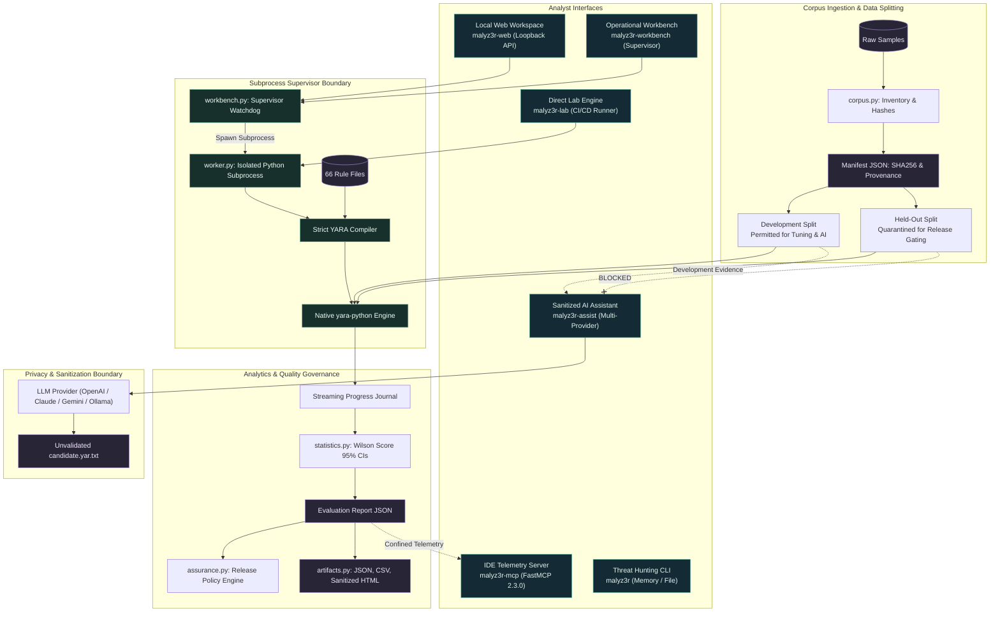

---

## Local Detection Assurance Workspace (`malyz3r-web`)

The `malyz3r-web` interface runs entirely locally over an authenticated loopback connection (`http://127.0.0.1:8765/`). Built with bundled HTML, CSS, JavaScript, and SVG, it requires zero external CDNs, build steps, or cloud infrastructure.

```bash
# Launch the local assurance console
malyz3r-web --workspace . --catalog workspace.example.json --port 8765
```

<p align="center">
  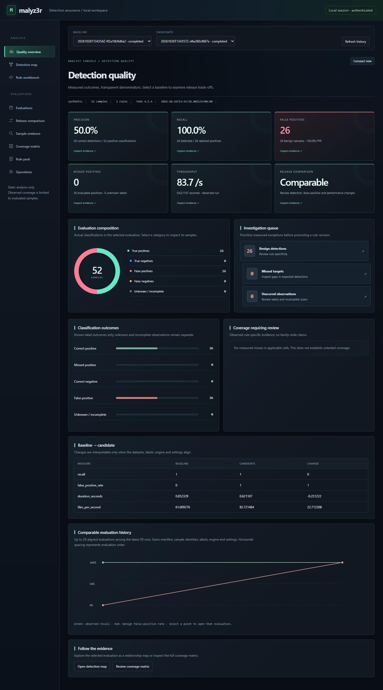
</p>

### Analytical Features & Capabilities:
- **Evidence-Linked Metric Cards**: Precision, Recall, False Positives, Missed Positives, and Scan Throughput link directly to underlying sample evidence. Clicking any card filters the investigation view to the contributing samples.
- **Outcome Composition Donut**: Visual breakdown separating True Positives, True Negatives, False Positives, False Negatives, and Unscored/Incomplete observations.
- **Investigation Queue**: One-click triage filters isolating benign samples mistakenly detected by candidate rules and missed malware targets.
- **Baseline vs. Candidate Drift**: Real-time delta tracking comparing candidate performance against baseline production runs across Recall, FPR, Scan Duration, and Throughput (samples/sec).
- **Longitudinal Calibration Trendlines**: Tracks metric trajectories across historical runs, ensuring rules maintain stability over successive authoring cycles.

---

## Evidence Model & Interactive Detection Map

In `malyz3r`, detection relationships are modeled as strict empirical evidence. A YARA rule match is an observed relationship to an individual sample byte sequence. It does not warrant an unverified claim that the rule detects an entire malware family:

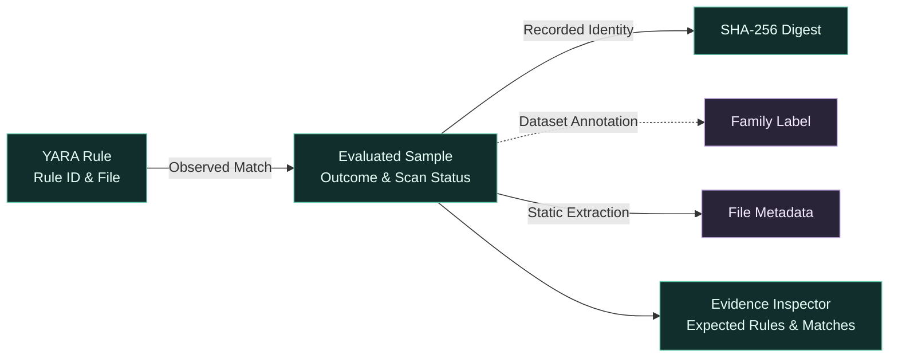

<p align="center">
  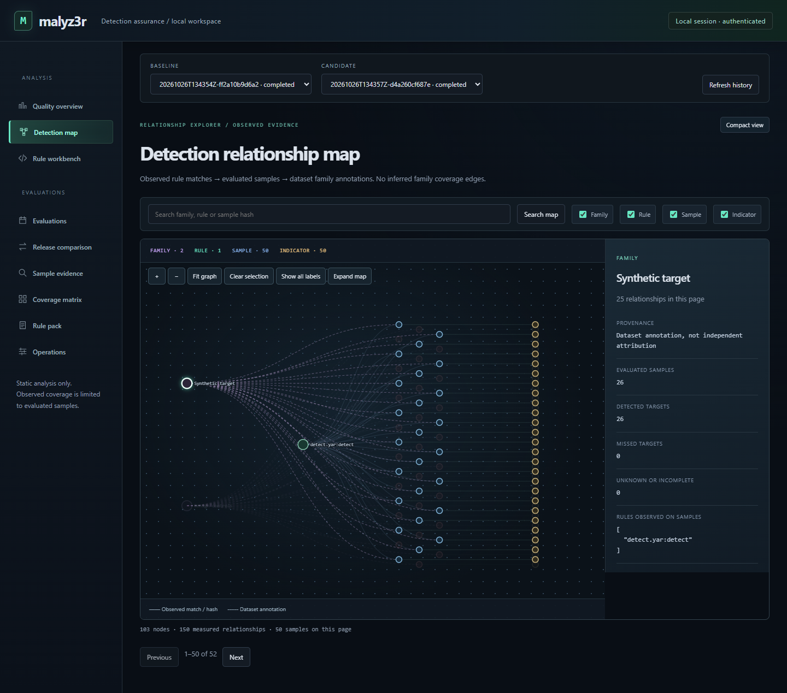
</p>

### Graph Explorer Capabilities:
- **Multi-Node Tier Filtering**: Dynamically toggle between Family annotations, compiled Rule detectors, evaluated Samples, and cryptographic SHA-256 Indicators.
- **Strict Evidence Edge Semantics**: Solid lines represent observed scan matches and hash identities; dashed lines indicate analyst-supplied ground truth metadata.
- **High-Performance Rendering**: Paginated (up to 50 samples per view) with strict caps (500 nodes, 1,000 edges) to guarantee fluid rendering on constrained field hardware.
- **Deep Provenance Drawer**: Selecting any node opens recorded details, evaluated sample counts, detected target counts, missed targets, and observed rule IDs.

---

## Supervisor Execution Protocol & Worker Boundary

To guarantee that untrusted binaries or catastrophic regex backtracking cannot compromise evaluation pipelines, `malyz3r` executes all YARA scans inside an isolated subprocess monitored by an active watchdog supervisor:

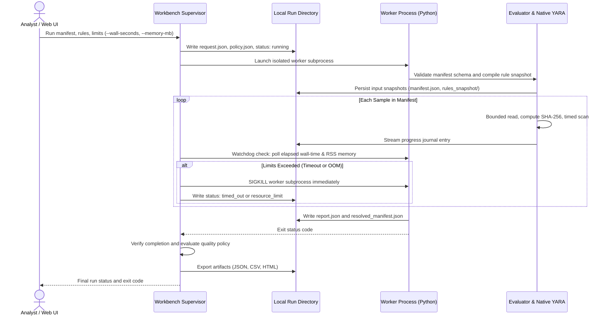

### Subprocess Run Lifecycle State Machine

Every execution run transitions deterministically through well-defined lifecycle states:

```mermaid
stateDiagram-v2
    [*] --> running: Run directory initialized
    running --> completed: Full evaluation completed; policy passed
    running --> rejected: Complete evaluation completed; policy failed
    running --> incomplete: Evaluation incomplete; scan errors present
    running --> timed_out: Worker exceeded --wall-seconds deadline
    running --> resource_limit: Worker RSS memory exceeded --memory-mb
    running --> failed: Native compiler crash or operational error
    running --> cancelled: Analyst user interrupt (SIGINT)
    completed --> [*]
    rejected --> [*]
    incomplete --> [*]
    timed_out --> [*]
    resource_limit --> [*]
    failed --> [*]
    cancelled --> [*]
```

---

## Sample Classification & Statistical Rigor

### Ground-Truth Metric Decision Flow

Every sample scan is classified through a rigorous decision tree to ensure that unknown labels, scan timeouts, and unexpected rule matches are never miscounted as clean negatives:

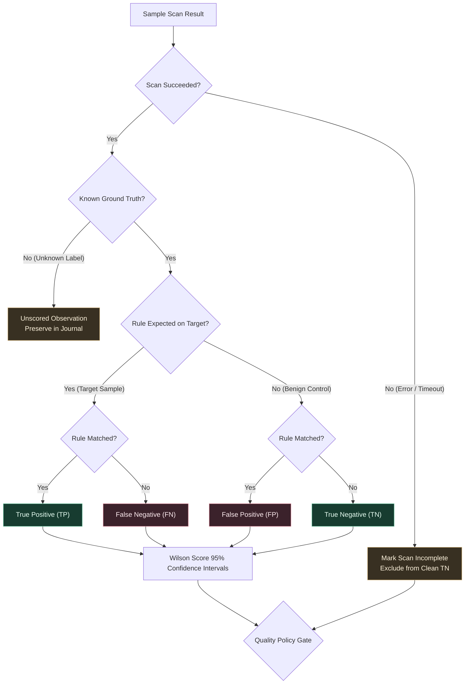

### Wilson Score Binomial Confidence Intervals

`malyz3r` automatically calculates **two-sided 95% Wilson score intervals** for all metric ratios:

$$\hat{p} = \frac{k + \frac{z^2}{2}}{n + z^2} \pm \frac{z}{n + z^2}\sqrt{\frac{k(n-k)}{n} + \frac{z^2}{4}}$$

*(where $k$ is successes, $n$ is trials, and $z = 1.96$ for a 95% confidence level)*

#### Point Estimates vs. Statistical Reality:
- **Small Corpus ($k=10, n=10$)**: Point Recall = **100%**, but 95% CI = **$[72.2\%, 100.0\%]$**.
- **Medium Corpus ($k=50, n=50$)**: Point Recall = **100%**, but 95% CI = **$[92.8\%, 100.0\%]$**.
- **Large Corpus ($k=200, n=200$)**: Point Recall = **100%**, but 95% CI = **$[98.1\%, 100.0\%]$**.

Quality policies enforce lower-bound confidence thresholds (`min_recall_lower95`), preventing rules from passing based on small-sample anomalies.

---

## Quality Gate Policies & Release Decisions

Candidate rule packs must satisfy automated release policies before production promotion:

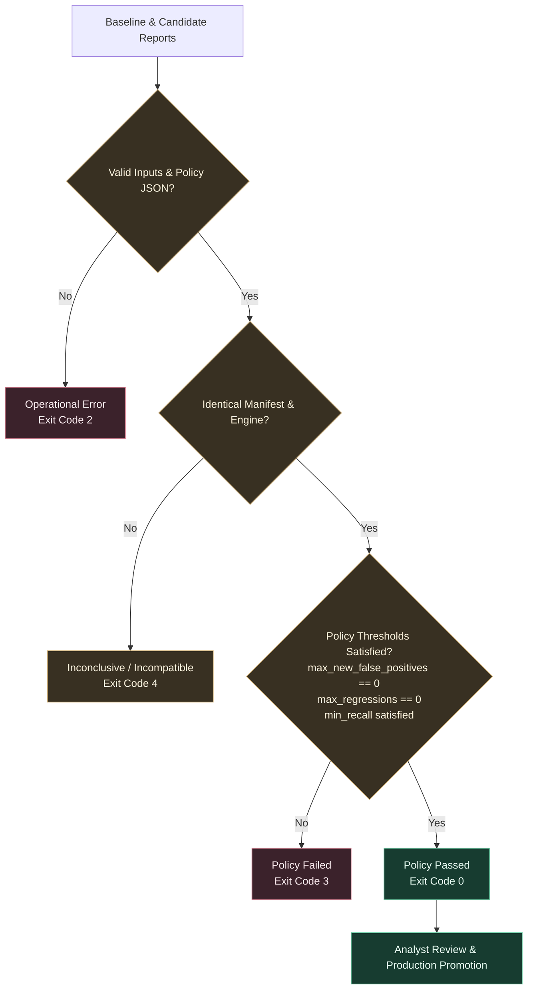

<p align="center">
  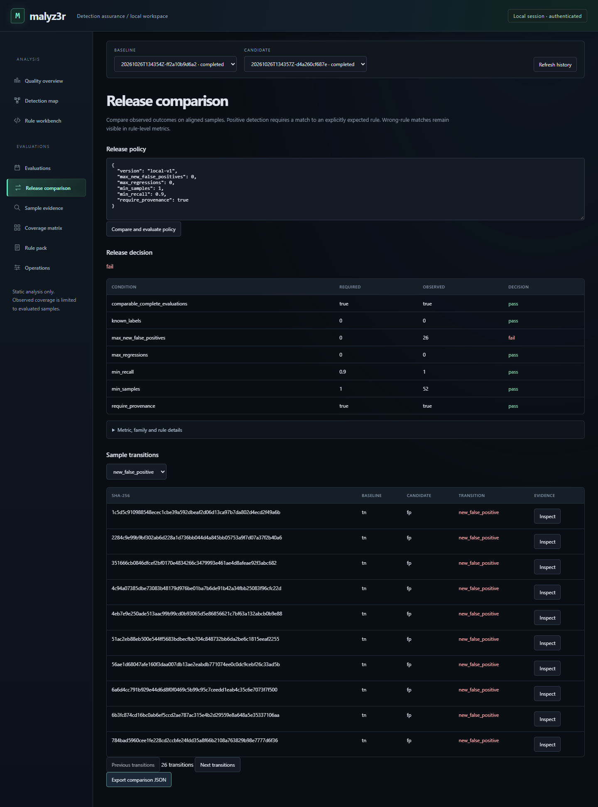
</p>

### Versioned Release Policy Schema (`policies/release-example.json`):
```json
{
  "version": "local-v1",
  "max_new_false_positives": 0,
  "max_regressions": 0,
  "min_samples": 1,
  "min_recall": 0.90,
  "require_provenance": true
}
```

### Deterministic Exit Codes for CI/CD Pipelines:
- **`0`**: **Pass** — Candidate satisfies all policy thresholds without regressions.
- **`3`**: **Fail** — Policy threshold violated (new false positive or dropped detection).
- **`4`**: **Inconclusive** — Incompatible evaluation manifests, unknown labels, or incomplete runs.
- **`2`**: **Operational Error** — Malformed JSON, missing files, or runtime exception.

---

## The 7-Phase Detection Engineering Lifecycle

```mermaid
flowchart LR
    Phase1["1. Ingest & Hash<br/>Deduplicate & Inventory"] --> Phase2["2. Assign Splits<br/>Dev vs. Held-Out"]
    Phase2 --> Phase3["3. Baseline Run<br/>Establish Benchmarks"]
    Phase3 --> Phase4["4. Author / Tune<br/>Edit Rules or AI Assist"]
    Phase4 --> Phase5["5. Candidate Run<br/>Supervised Worker"]
    Phase5 --> Phase6["6. Regression Diff<br/>Sample Transitions"]
    Phase6 --> Phase7["7. Release Gate<br/>Policy Decision"]
    Phase7 -->|"Fail (Exit 3)"| Phase4
    Phase7 -->|"Pass (Exit 0)"| Promote["Analyst Promotion<br/>Production Deploy"]

    classDef phase fill:#162d38,stroke:#75acbf,color:#e7f5fa;
    classDef promote fill:#173c30,stroke:#6cc7a2,color:#e8fff3;
    class Phase1,Phase2,Phase3,Phase4,Phase5,Phase6,Phase7 phase;
    class Promote promote;
```

1. **Ingest & Hash**: Scans incoming samples with `malyz3r-workbench inventory`, computing SHA-256 digests and deduplicating identical binaries.
2. **Assign Splits**: Explicitly marks samples as `development` (used for active tuning) or `held-out` (quarantined strictly for unbiased quality gating).
3. **Baseline Run**: Evaluates production rules against the manifest to establish baseline metrics.
4. **Author & Tune**: Detection engineers modify YARA rules in `malware_scanner/rules/` or use `malyz3r-assist`.
5. **Candidate Run**: Evaluates candidate rules against the identical dataset manifest under supervisor control.
6. **Regression Diffing**: Executes `malyz3r-workbench compare` or `malyz3r-assurance` to trace sample transitions.
7. **Release Gate**: Enforces the release policy, generating deterministic exit codes.

---

## Comprehensive Threat Detection Catalog (66 Files / 69 Detectors)

The detection catalog in [`malware_scanner/rules/`](malware_scanner/rules/) covers **66 battle-tested YARA rule files** containing **69 discrete threat detectors** mapped against MITRE ATT&CK tactics:

| Category | Files | Threat Families & Detectors | MITRE ATT&CK Mapping | Detection Mechanism |
| :--- | :---: | :--- | :--- | :--- |
| **Advanced Persistent Threats (APT)** | 8 | • APT28 (Sofacy / Fancy Bear CHOPSTICK/SPLM)<br>• APT29 (Cozy Bear / Nobelium / SolarWinds)<br>• Lazarus Group (HIDDEN COBRA / BlueNoroff)<br>• MuddyWater (Seed / POWERSTATS)<br>• OilRig (Helix Kitten / BONDUPDATER)<br>• Sandworm (BlackEnergy / Industroyer)<br>• Turla (Snake / Uroburos)<br>• Winnti Group (APT41 / Barlaiy) | T1071 (Application Layer Protocol)<br>T1059 (Command & Scripting)<br>T1105 (Ingress Tool Transfer)<br>T1027 (Obfuscated Files) | Characteristic C2 URI patterns, registry persistence keys, unique XOR decryption routines, and hardcoded mutex strings. |
| **Ransomware** | 12 | • Babuk Locker (ESXi / Win)<br>• BlackCat (ALPHV Rust-based)<br>• Clop (TA505 / FIN11)<br>• Conti (Wizard Spider v1-v3)<br>• DarkSide / BlackMatter<br>• Hive (Go/Rust variants)<br>• LockBit 3.0 (LockBit Black)<br>• Phobos / Elrond / 8base<br>• Play (PlayCrypt)<br>• REvil (Sodinokibi)<br>• Rhysida<br>• WannaCry (WanaCrypt0r 2.0) | T1486 (Data Encrypted for Impact)<br>T1490 (Inhibit System Recovery)<br>T1489 (Service Stop) | VSS deletion commands (`vssadmin delete shadows`), ransom note templates, encryption marker footers, and cryptographic API imports (`BCryptGenRandom`, `CryptEncrypt`). |
| **Infostealers** | 9 | • AgentTesla (.NET Keylogger)<br>• Ducktail (Facebook Business Stealer)<br>• FormBook / XLoader<br>• LummaC2 (Lumma Stealer C2)<br>• Meduza Stealer<br>• Raccoon Stealer (v1 & v2)<br>• RedLine Stealer<br>• Stealc (C-based Stealer)<br>• Vidar Stealer | T1005 (Data from Local System)<br>T1555 (Credentials from Password Stores)<br>T1539 (Steal Web Session Cookie)<br>T1115 (Clipboard Data) | Browser profile paths (`Login Data`, `Cookies`), crypto wallet directory targets, Telegram session paths, and base64 C2 exfiltration patterns. |
| **Remote Access Trojans (RAT)** | 9 | • AsyncRAT (.NET open-source RAT)<br>• Cobalt Strike Beacon (Malleable C2 & Shellcode)<br>• Havoc Demon C2<br>• IcedID (BokBot Banking RAT)<br>• njRAT (Bladabindi)<br>• QuasarRAT (.NET RAT)<br>• Remcos RAT (BreakingSecurity)<br>• ShadowPad (APT41 shared tool)<br>• Sliver C2 (BishopFox Go framework) | T1219 (Remote Access Software)<br>T1059.001 (PowerShell)<br>T1056.001 (Keylogging)<br>T1095 (Non-Application Layer Protocol) | Default C2 TLS certificates, protocol handshakes, reflective loader stubs, beacon configuration blocks, and keylogger hooks. |
| **WebShells** | 6 | • ASPX Spy<br>• b374k (PHP WebShell)<br>• China Chopper (Minimal 1-liner & Client)<br>• Godzilla Memory Shell<br>• Weevely (Steganographic PHP WebShell)<br>• WSO (Web Shell by Orb) | T1505.003 (Server Component: Web Shell)<br>T1059.004 (Unix Shell)<br>T1059.006 (Python) | PHP `eval(base64_decode(...))`, ASPX `.NET` compilation directives, JSP reflective classloader invocations, and command execution primitives (`system`, `passthru`, `proc_open`). |
| **Botnets & Loaders** | 6 | • Emotet (HeLoader / Geodo)<br>• Gafgyt / Qbot (BASHLITE IoT)<br>• Mirai (Telnet brute-force IoT)<br>• Mozi (P2P IoT Botnet)<br>• QakBot (Pinkslipbot / Qbot)<br>• TrickBot (Anchor / BazarLoader) | T1584.005 (Botnet)<br>T1110.001 (Password Guessing)<br>T1498 (Network Denial of Service)<br>T1105 (Ingress Tool Transfer) | Telnet credential dictionaries, IoT cross-compilation strings (MIPS/ARM), P2P DHT routing signatures, and multi-stage DLL unpacker exports. |
| **Destructive Wipers** | 4 | • CaddyWiper<br>• HermeticWiper (FoxBlade)<br>• NotPetya (EternalBlue wiper)<br>• Shamoon (Disttrack wiper) | T1561.001 (Disk Content Wipe)<br>T1561.002 (Disk Structure Wipe)<br>T1490 (Inhibit System Recovery) | Raw disk handles (`\\.\PhysicalDrive0`), MBR overwriting loops, partition table zeroing, and SCSI/IDE miniport driver manipulation. |
| **Exploitation & Injections** | 4 | • EternalBlue (MS17-010 SMBv1 exploit)<br>• Log4Shell (CVE-2021-44228 JNDI injection)<br>• Process Hollowing (`NtUnmapViewOfSection`)<br>• Reflective DLL Injection (`ReflectiveLoader`) | T1210 (Exploitation of Remote Services)<br>T1190 (Exploit Public-Facing Application)<br>T1055.012 (Process Hollowing)<br>T1055.001 (Dynamic-link Library Injection) | SMBv1 FEA list buffer overflow patterns, `${jndi:ldap://}` string patterns, API injection sequences (`VirtualAllocEx` -> `WriteProcessMemory` -> `SetThreadContext`), and MZ PE search loops. |
| **Miners & Rootkits** | 2 | • XMRig Stratum Cryptominer<br>• Kernel Hooking Rootkits (Win/Linux) | T1496 (Resource Hijacking)<br>T1014 (Rootkit)<br>T1068 (Privilege Escalation) | Stratum mining protocol commands (`mining.subscribe`, `mining.authorize`), Monero pool endpoints, `/dev/kmem` manipulation, and SSDT hook signatures. |
| **Baseline Heuristics** | 6 | • Generic Trojans<br>• Generic Ransomware indicators<br>• Generic Worm propagation<br>• Phishing login scripts<br>• Static PE header anomalies<br>• Advanced heuristic behavioral markers | T1204 (User Execution)<br>T1566 (Phishing)<br>T1027 (Obfuscated Files)<br>T1129 (Shared Modules) | High PE section entropy (> 7.2), suspicious section names (`.upx`, `.vmp`, `.themida`), suspicious import hashes, and phishing form actions (`action="http..."`). |

---

## Corpus Manifest Schema & Split Governance

Corpus manifests establish ground truth for empirical verification:

```json
{
  "name": "apt28-and-ransomware-corpus-2026",
  "kind": "empirical",
  "samples": [
    {
      "path": "samples/apt28_dropper.bin",
      "label": "target",
      "expected_rules": [
        "apt_fancybear_sofaciy.yar:APT28_Sofacy_CHOPSTICK"
      ],
      "split": "development",
      "provenance": "CISA-Alert-AA23-180A",
      "family": "Sofacy",
      "sha256": "450dd0ace070e08635b19c9179150da4f81e30ea5c77538dbc880ad86863db37"
    },
    {
      "path": "samples/clean_system32_calc.exe",
      "label": "benign",
      "expected_rules": [],
      "split": "held-out",
      "provenance": "Windows-11-23H2-Clean-Install",
      "sha256": "a9538c5f4654a0752920c45015febcc0e37fb83f32c73e26025747d33d10b6af"
    }
  ]
}
```

### Split Governance Rules:
- **`development`**: Permitted for active rule authoring, iterative tuning, and LLM assistant evidence generation.
- **`held-out`**: Quarantined strictly for unbiased quality gating. Never shared with AI providers or tuning loops.
- **`unspecified`**: Evaluated normally, but rejected by policies requiring split isolation (`require_held_out: true`).

---

## Multi-Provider AI Assistant (`malyz3r-assist`)

Leverages Large Language Models to analyze development misclassifications and suggest candidate rule refinements with guaranteed zero data leakage:

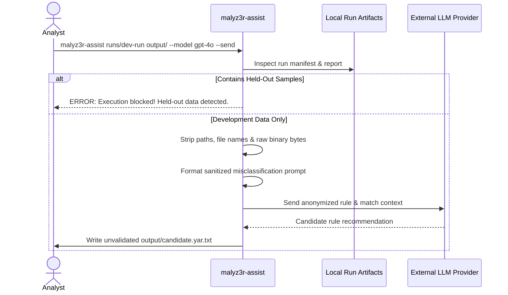

### Supported Providers & Invocation:
```bash
# 1. Safe Offline Preview Mode (Zero network calls)
malyz3r-assist runs/run-2026-01 preview-output/ --model gpt-4o

# 2. OpenAI GPT-4o
export OPENAI_API_KEY="sk-..."
malyz3r-assist runs/run-2026-01 advice-openai/ --model gpt-4o --send --include-rule-source

# 3. Anthropic Claude 3.5 Sonnet
export ANTHROPIC_API_KEY="sk-ant-..."
malyz3r-assist runs/run-2026-01 advice-claude/ --provider anthropic --model claude-3-5-sonnet-20241022 --send --include-rule-source

# 4. Google Gemini 1.5 Pro
export GEMINI_API_KEY="..."
malyz3r-assist runs/run-2026-01 advice-gemini/ --provider gemini --model gemini-1.5-pro --send --include-rule-source

# 5. Local Offline LLM (Ollama or vLLM)
malyz3r-assist runs/run-2026-01 advice-local/ --provider openai-compatible \
  --base-url "http://localhost:11434/v1" --model llama3 --send --include-rule-source
```

---

## FastMCP IDE Integration (`malyz3r-mcp`)

Implements the Model Context Protocol (FastMCP 2.3.0) over stdio, allowing AI coding assistants in Cursor, Claude Desktop, and Antigravity to inspect runs safely:

### Configuration (`cursor.json` / `claude_desktop_config.json`):
```json
{
  "mcpServers": {
    "malyz3r": {
      "command": "python",
      "args": [
        "-m", "malware_scanner.mcp_server",
        "--workspace", "C:/Users/Acer/Documents/ChatGPT/YARA"
      ]
    }
  }
}
```

### Exposed MCP Tools:
- **`development_evidence`** (`readOnlyHint=true`): Reads a completed development run confined strictly to the local workspace; immediately rejects runs containing `held-out` validation data.
- **`request_advice`** (`readOnlyHint=false`): Submits sanitized development evidence to the configured provider upon explicit user confirmation (`confirm_send=true`).

---

## Interactive Threat Hunting CLI & Direct Lab

### 1. Direct Evaluation Engine (`malyz3r-lab`)
Fast, single-process evaluator designed for CI/CD smoke tests:
```bash
python -m malware_scanner.lab samples/lab/manifest.json \
  --rules malware_scanner/rules \
  --strict \
  --timeout 10 \
  --output report.json
```

### 2. Operational Workbench (`malyz3r-workbench`)
Manage manifests, execute supervised runs, and compare diffs:
```bash
# Inventory sample directory
malyz3r-workbench inventory /path/to/samples --provenance "IR-Case-01" \
  --label target --split development --output manifest.json

# Supervised execution run
malyz3r-workbench run manifest.json malware_scanner/rules runs/run-01 \
  --wall-seconds 180 --memory-mb 512 --policy policies/research.json

# Regression diff
malyz3r-workbench compare runs/baseline runs/candidate --output comparison.json
```

### 3. Interactive Threat Hunting CLI (`malyz3r`)
Interactive terminal tool for memory scanning and ad-hoc file inspection:
```bash
python run_scanner.py
# or
malyz3r
```
- File & Directory multi-threaded scanning against 66 rule packs.
- Process Virtual Memory scanning for injected payloads and reflective DLLs.
- Hexdump and string preview for suspicious byte sequences.
- VirusTotal v3 hash queries (requires `VT_API_KEY`).

---

## Installation & Environment Setup

### Prerequisites
- **Python**: 3.10, 3.11, 3.12, or 3.13 (64-bit).
- **Windows**: Microsoft Visual C++ 2015-2022 Redistributable.
- **Linux**: Build essentials and OpenSSL development headers:
  ```bash
  sudo apt-get update && sudo apt-get install -y build-essential libssl-dev python3-dev
  ```

### Installation Steps
```bash
# 1. Clone repository
git clone https://github.com/gl1tch0x1/malyz3r.git
cd malyz3r

# 2. Create isolated virtual environment
python -m venv .venv

# Activate (Linux/macOS):
source .venv/bin/activate
# Activate (Windows PowerShell):
.\.venv\Scripts\Activate.ps1

# 3. Install dependencies pinned against strict constraints
python -m pip install -c constraints.txt .

# 4. (Optional) Install FastMCP IDE telemetry server (Python 3.11+ required)
python -m pip install ".[mcp]"
```

---

## Docker Packaging & Corpus Persistence

The Docker image packages the runtime and public detectors while keeping private malware corpora outside the build context:

```bash
# Build analyst container
docker build -t malyz3r:latest .

# Run complete validation suite in container
docker run --rm malyz3r:latest python tests/run_validation.py

# Execute supervised evaluation mounting host corpus and runs directory
docker run --rm -v "$(pwd)/runs:/app/runs" -v "/path/to/corpus:/app/local-corpus:ro" malyz3r:latest \
  malyz3r-workbench run samples/lab/manifest.json --rules malware_scanner/rules \
  --runs-dir runs/container-run-01 --wall-seconds 120 --memory-mb 512
```

---

## Automated Testing & CI/CD Verification

```bash
# 1. Run all unit tests
python -m unittest discover -s tests -v

# 2. Check formatting and linting with Ruff
python -m ruff check
python -m ruff format --check

# 3. Execute the full end-to-end CI validation suite
python tests/run_validation.py

# 4. Verify clean wheel build and installation
python tests/smoke_install.py

# 5. Run Playwright browser UI assurance checks
python tests/browser_assurance.py --channel chrome --screenshot runs/ui-validation/release-comparison.png
```

### Static Type Safety
- Configured for **Pyright / Pylance** static analysis (`pyproject.toml`).
- Native C-extension type stubs defined in [`typings/yara.pyi`](typings/yara.pyi).

---

## Repository Structure

```
.
├── malware_scanner/          # Core Python package
│   ├── rules/                # 66 candidate YARA rule files (69 detectors)
│   ├── __init__.py           # Package version definition
│   ├── assurance.py          # Sample comparisons, coverage & release policy
│   ├── web.py                # Authenticated loopback API & web entry point
│   ├── web_workspace.py      # Graph, compatible history & draft adapters
│   ├── web_assets/           # Bundled HTML, CSS, JavaScript and SVG UI
│   ├── artifacts.py          # Report export (JSON, CSV, sanitized HTML)
│   ├── assistant.py          # Multi-provider LLM assistant (OpenAI, Claude, Gemini, Ollama)
│   ├── benchmark.py          # Benchmark harness and performance matrix
│   ├── cli.py                # Interactive threat hunting terminal CLI
│   ├── corpus.py             # Manifest inventory, merge, and verification
│   ├── lab.py                # Strict YARA compiler and evaluation engine
│   ├── mcp_server.py         # FastMCP stdio server for IDE integration
│   ├── providers.py          # API client adapters for LLM providers
│   ├── quality.py            # Quality policy enforcement and regression diffs
│   ├── scanner.py            # Core file and memory scanning engine
│   ├── statistics.py         # Wilson score binomial confidence interval calculator
│   ├── workbench.py          # Subprocess supervisor and analyst workflow CLI
│   └── worker.py             # Supervised child process worker
├── datasets/                 # Packaged evaluation and calibration datasets
├── docs/                     # Comprehensive documentation & architectural guides
│   ├── diagrams/             # Architectural Mermaid diagrams and vector SVGs
│   └── images/               # Curated demo screenshots and visual assets
├── local-corpus/             # Local sample corpora mount point
├── samples/lab/              # Harmless synthetic test fixtures and manifests
├── scripts/                  # Automation and rule generation scripts
├── tests/                    # 72 comprehensive unit/integration tests and browser harness
├── typings/                  # Static type stubs for native extensions (yara.pyi)
├── Dockerfile                # Production Docker container definition
├── Dockerfile.validation     # Pinned CI validation container
├── pyproject.toml            # Project packaging metadata, Ruff and Pyright config
├── constraints.txt           # Pinned dependency constraints
├── workspace.example.json    # Example catalog using synthetic fixtures
├── policies/                 # Per-rule and versioned release policies
├── ASSURANCE.md              # Web workspace and scoring specification
├── VALIDATION.md             # Dated verification results and platform matrix
├── MCP.md                    # Detailed Model Context Protocol guide
└── README.md                 # Project documentation
```

---

## Honest Disclaimers & Operational Boundaries

> [!IMPORTANT]
> **Project Status: Single-analyst evaluation workbench and research harness. Read the following operational realities before deploying or evaluating this software.**

1. **Not an Antivirus, EDR, or Real-Time Shield**: `malyz3r` is an on-demand, batch-oriented static rule evaluator. It does **not** install a kernel minifilter, intercept live system calls, monitor network packets, or terminate processes in real time.
2. **Not a Dynamic Sandbox or Detonation Chamber**: Files are parsed strictly as byte buffers. `malyz3r` does not execute binaries, unpack runtime payloads, or inspect dynamic API call traces. Live malware **must be isolated in an air-gapped or dedicated analysis virtual machine**.
3. **Static Rule Limitations (Packers & Crypters)**: YARA operates on static byte sequences and PE headers. If a binary is packed with UPX, Themida, VMProtect, or a custom polymorphic runtime crypter, plain-text string signatures will fail until unpacked.
4. **Worker Process Boundary != OS Sandbox**: The workbench supervisor executes rule evaluations inside a child Python subprocess guarded by wall-clock timers and memory caps. **It is not an operating system security boundary** (such as a seccomp jail or microVM).
5. **Heuristic Candidate Rules, Not Certified Feeds**: The 66 bundled YARA rule files are open-source detection engineering heuristics curated from public threat reports. Local tuning and allowlisting are mandatory.
6. **Analysts Establish Ground Truth**: `malyz3r` calculates detection metrics strictly against analyst-provided manifests. It has no independent awareness of true malware status. Inaccurate ground truth manifests will produce deceptive metrics.
7. **Synthetic Fixtures vs. Wild Corpora**: The test fixtures in [`samples/lab/`](samples/lab/) are harmless synthetic files crafted for deterministic CI regression testing. Achieving 100% precision and recall on synthetic fixtures **does not imply high real-world efficacy against evolving malware in the wild**.
8. **AI Assistant Guardrails**: Large Language Models frequently hallucinate invalid YARA syntax and regex constructs. `malyz3r-assist` outputs non-executable draft suggestions (`candidate.yar.txt`). Human review is mandatory.
9. **VirusTotal OPSEC & Rate Limits**: VirusTotal API v3 integration requires an analyst API key. Querying or submitting proprietary hashes or sensitive incident artifacts to public multi-scanner engines may expose confidential engagement data.

---

## License & Attribution

Distributed under the **MIT License**. See [LICENSE](LICENSE) for details.

Created by [gl1tch0x1](https://github.com/gl1tch0x1). Enhanced and maintained by detection engineering and threat research teams.
