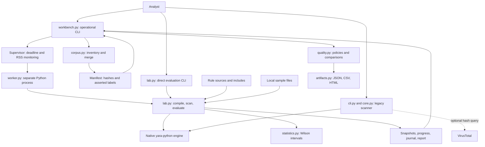
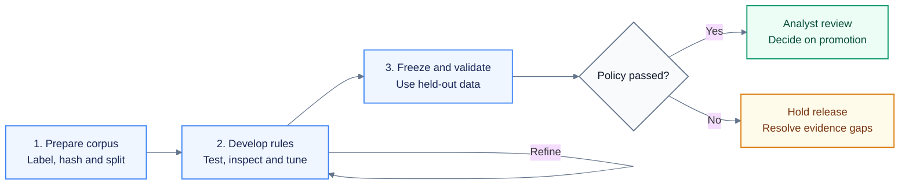
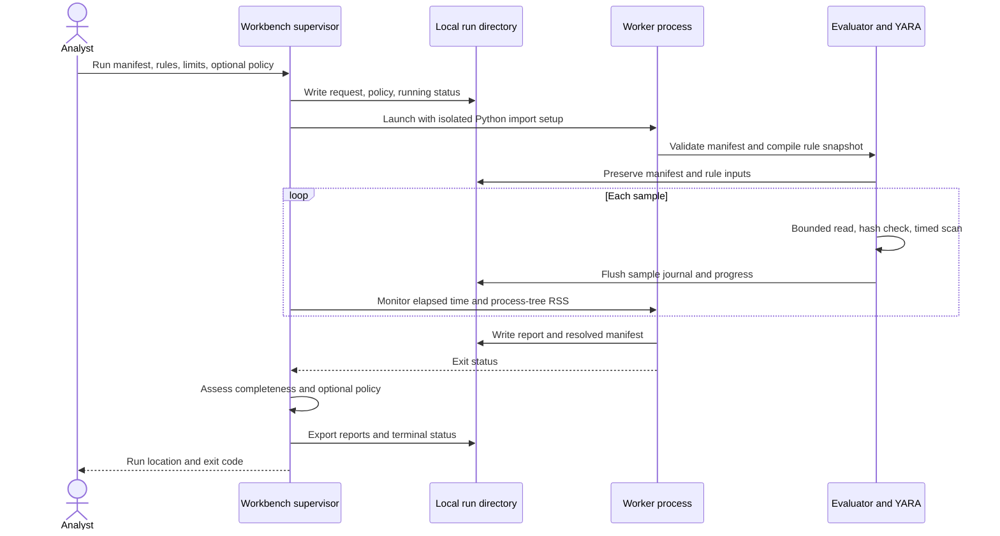
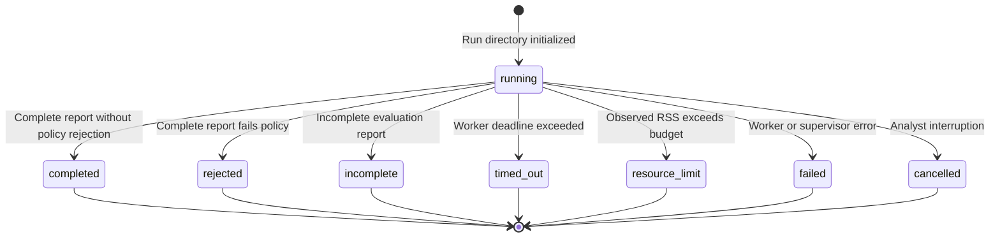
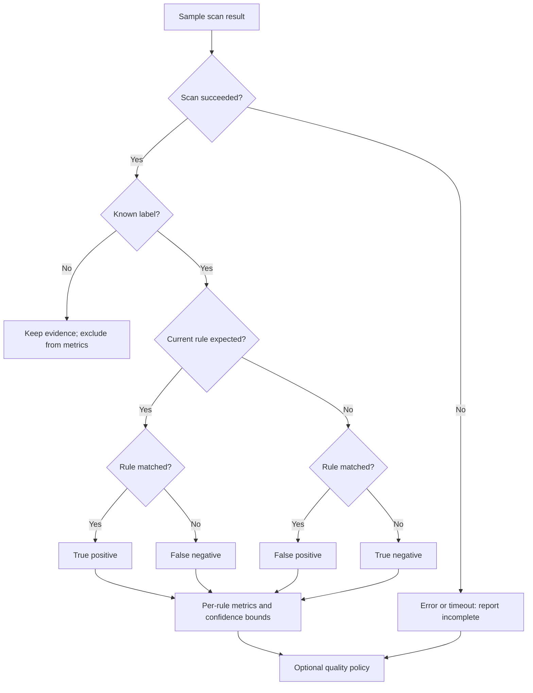
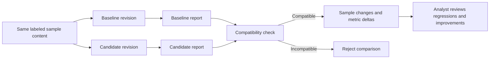

# malyz3r — YARA Rule Engineering Lab

Local Python tooling for static YARA scanning, labeled-corpus evaluation, and reproducible rule comparisons. The workbench helps analysts inventory files, test rules, inspect false positives and missed targets, and apply explicit quality policies before deciding whether to promote a revision.

**Status: experimental research software for a single analyst workstation.** The operational CLI is implemented and has passed local Windows and Linux checks. Bundled rules are candidate heuristics, not independently validated malware-family signatures. No labeled real-malware benchmark has been completed, and no production detection-rate claim is made.

Analysts author and tune rules and establish ground truth; malyz3r supplies evaluation and evidence. It does not automatically generate rules. It is not an antivirus replacement, malware detonation sandbox, endpoint agent, or multi-user hosted service.

## Contents

- [Capabilities and interfaces](#capabilities-and-interfaces)
- [System architecture](#system-architecture)
- [Installation](#installation)
- [Quick start](#quick-start)
- [Analyst workflow](#analyst-workflow)
- [Dataset contract](#dataset-contract)
- [GitHub dataset and rule calibration](#github-dataset-and-rule-calibration)
- [Execution and failure handling](#execution-and-failure-handling)
- [Metrics and quality gates](#metrics-and-quality-gates)
- [Evidence and comparison](#evidence-and-comparison)
- [Legacy scanner](#legacy-scanner)
- [Security boundaries](#security-boundaries)
- [Validation and development](#validation-and-development)
- [Repository guide](#repository-guide)
- [Remaining work](#remaining-work)

## Capabilities and interfaces

Three installed commands serve different purposes:

- **`malyz3r-workbench`** is the operational interface: `inventory`, `merge`, `run`, `inspect`, and `compare`; supervised workers; persistent evidence; JSON/CSV/HTML reports; and configurable quality gates.
- **`malyz3r-lab`** runs the evaluator directly, useful for development fixtures and simple automation. It does not provide the workbench's separate supervisor or whole-worker resource limits.
- **`malyz3r`** is the legacy scanner and investigation interface: file/directory scans, process-memory scans, metadata inspection, rule management, and optional VirusTotal hash lookups. Auxiliary features have not received the same end-to-end validation as the evaluation workflow.

Implemented evaluation features include strict compilation, bounded reads, scan timeouts, SHA256 verification, provenance and split metadata, per-rule confusion matrices, confidence intervals, and compatible-run comparison. Unknown labels and scan failures are distinguished from benign nonmatches.

## System architecture

The Mermaid diagrams below describe the implemented application. GitHub renders these fences directly; other Markdown viewers need Mermaid support. The CLI does not require a JavaScript runtime or diagram service.



The application stores state in local files, without a database or background service. The worker runs under the analyst's account. Its process boundary helps contain failures; it does not isolate hostile code from the host.

## Installation

Requires **Python 3.10 or newer** and a working `yara-python` installation. Local validation has exercised Python 3.13 on Windows and Linux, plus Python 3.10 in the restricted Linux container. Windows Python 3.10 and macOS have not been locally validated.

```console
git clone https://github.com/gl1tch0x1/malyz3r.git
cd malyz3r
python -m venv .venv
```

Activate the virtual environment:

```powershell
# Windows PowerShell
.\.venv\Scripts\Activate.ps1
```

```bash
# Linux / macOS shell
source .venv/bin/activate
```

Install the runtime versions recorded during validation:

```console
python -m pip install -c constraints.txt .
malyz3r-workbench --help
```

`constraints.txt` pins tested versions; it is not a hash-locked supply-chain guarantee. Review dependency updates and rerun validation when changing them. `python -m pip install .` is also supported but may resolve different versions.

The evaluator uses the Python YARA binding, not the separate `yara` executable. Metadata features may additionally require system libmagic or ExifTool; investigation helpers use optional `strings` and `hexdump` utilities. These external tools are not required for the lab workflow. The legacy shell script requires the separate YARA executable.

## Quick start

From the repository root after installation:

```console
malyz3r-lab samples/lab/manifest.json --strict --output report.json
malyz3r-workbench run samples/lab/manifest.json --rules malware_scanner/rules --runs-dir runs
```

The first command checks regression fixtures. The second creates a unique run directory and prints its location and status. Open its `report.html` or inspect its status:

```console
malyz3r-workbench inspect runs/RUN_ID
```

Replace `RUN_ID` with the actual directory name. Source-module equivalents are `python -m malware_scanner.lab` and `python -m malware_scanner.workbench` with the same arguments.

The bundled dataset contains **18 harmless synthetic text fixtures covering nine public rules**. Passing it demonstrates matching behavior on those fixtures, not real malware recall or operational false-positive rates. Running these fixtures against the research release policy is expected to be rejected.

## Analyst workflow

Prepare the evidence, iterate on development data, then validate a frozen candidate.



Unknown files remain triage-only until labeled. A policy pass leads to analyst review, not automatic promotion. If held-out results influence further tuning, use fresh independent data for the next validation.

### 1. Inventory an unlabeled collection

Replace paths with existing local directories. Keep manifests outside the corpus and use a new output filename for each inventory.

```console
malyz3r-workbench inventory local-corpus/incoming --output manifests/incoming.json --provenance "Case 42: local analyst collection"
```

Inventory defaults to `unknown`; it does not classify files. It records hashes, duplicates, skipped paths, errors, and truncation without copying or modifying samples. Symlinks and directory links are skipped. Defaults are 10,000 files and 64 MiB per file. Resolve incomplete inventories before release evaluation.

### 2. Record justified labels and merge

These commands are templates for **already adjudicated** collections. A filename, YARA hit, or vendor score alone is not ground truth.

```console
malyz3r-workbench inventory local-corpus/clean --output manifests/clean.json --provenance "Verified distribution; record evidence" --label benign --split held_out
malyz3r-workbench inventory local-corpus/family-a --output manifests/family-a.json --provenance "Analyst-adjudicated family A; record evidence" --label target --family family-a --expected-rule family-a.yar:Family_A --split held_out
malyz3r-workbench merge manifests/clean.json manifests/family-a.json --output manifests/evaluation.json
```

`family-a.yar:Family_A` is a placeholder, not a bundled rule. Replace it with an actual stable rule ID. Repeat `--expected-rule` for overlapping expected detections. Merge rejects conflicting labels, missing required hashes, incomplete inventories, and identical content assigned to different splits. Related variants and near-duplicates still require analyst review.

### 3. Run and inspect

```console
malyz3r-workbench run manifests/evaluation.json --rules rules/candidate --runs-dir runs --wall-seconds 300 --memory-mb 512 --policy policies/research-release.json
malyz3r-workbench inspect runs/RUN_ID
```

Use your own rule directory in place of `rules/candidate`. Without `--policy`, a complete run means scanning completed; **quality was not evaluated**. Inspect the report and terminal status rather than interpreting process success as effective detection.

## Dataset contract

A manifest contains `name`, `kind`, and a nonempty `samples` list. Each sample supplies a path, label, and expected rule IDs; optional fields include SHA256, family, provenance, and split. Inventory creates real-collection manifests; [the fixture manifest](samples/lab/manifest.json) is a complete synthetic example.

- **`target`**: one or more specific rules are expected to match; `expected_rules` must be nonempty.
- **`benign`**: no rule is expected to match; `expected_rules` must be empty.
- **`unknown`**: scanned for triage, excluded from detection metrics; `expected_rules` must be empty.

Rule IDs use `relative-rule-file:RuleName`. A sample labeled for one family is a negative for other rules unless those rules are also explicitly expected. Changing these expectations changes the evaluation question.

Paths resolve relative to the manifest. Absolute paths and paths outside its directory are allowed so private samples can remain separate. Treat manifests as trusted analyst inputs. SHA256 pins are optional for hand-authored evaluator manifests but generated by inventory and required by merge. Duplicate content and unknown expected rule IDs are rejected during evaluation.

## GitHub dataset and rule calibration

A reproducible optional workflow imports **2,448 unique real PHP source files**
from pinned revisions of WordPress and tennc/webshell. It uses 1,981 development
files to calibrate three explicit candidate YARA rules and reserves 467 files for
evaluation after selection. This is rule calibration, not machine-learning training.

```console
python -m malware_scanner.dataset datasets/github-php.json --output local-corpus/github-php
python -m malware_scanner.benchmark local-corpus/github-php --output runs/github-php-experiment
```

Use new output directories. Files are saved under content hashes with `.bin`
extensions and never executed. Archives and individual files are hashed; manifests
record source URLs, source-derived labels, and deterministic split assignments.
The candidate rule remains separate from the bundled detector rules.

**These labels are source assertions, not independent ground truth.** WordPress
files are assumed benign; the webshell collection may contain helpers and examples.
Exact duplicate removal does not prevent related-variant leakage. This corpus is
useful for exploratory PHP detection research but does not validate executable
malware families or meet the existing release policy's evidence requirements.
See the [dataset card](datasets/README.md) for licensing, reproduction, and limits.

## Execution and failure handling



This sequence shows the normal path. Failed workers may leave partial evidence without final reports. Invalid inputs may fail before a run directory is created.



Workbench exit codes:

- **0**: completed operation.
- **1**: incomplete/failed/resource-limited run or incomplete inventory.
- **2**: invalid command/input.
- **3**: rejected policy or comparison regression.
- **130**: analyst cancellation.

Consult `status.json` for the specific run outcome. The direct lab uses 0 for complete, 1 for incomplete, and 2 for invalid input/compilation/output failure. With `--strict`, a complete run returns 3 for false positives, false negatives, or unknown labels. The legacy scanner returns 0 for completed file/directory scans whether or not matches occur.

## Metrics and quality gates



Per-rule recall is `TP / (TP + FN)`, precision is `TP / (TP + FP)`, F1 is `2TP / (2TP + FP + FN)`, and off-target FPR is `FP / (FP + TN)`. Undefined ratios are JSON `null`.

**Off-target FPR includes other target families as negatives.** Separate benign-only FPR counts only benign samples. Reports include two-sided 95% Wilson intervals for recall and benign FPR. Zero observed false positives on a small corpus does not establish a low population FPR. Intervals cannot correct biased sampling or correlated samples; precision also depends on dataset composition.

Errors and timeouts are excluded from denominators and make the report incomplete. Such metrics describe only the successfully evaluated subset and must not be treated as a valid release result.

The [example release policy](policies/research-release.json) requires:

- At least 30 target examples per selected rule and 4,000 benign samples.
- Recall at least 0.90 and benign FPR at most 0.001.
- Recall's 95% lower bound at least 0.80 and benign FPR's 95% upper bound at most 0.001.
- Complete evaluation/inventory, no unknown labels, and held-out nonsynthetic evidence.

These are analyst starting thresholds, **not an industry standard or certification**. All rules are selected by default; a policy's optional `rules` list narrows the selected IDs. Labels and splits are analyst assertions, not independently verified by the application. Passing establishes only the expressed checks.

## Evidence and comparison

Successful runs produce a timestamp/UUID directory. Failure paths may contain only a subset of these files:

```text
runs/RUN_ID/
  status.json                  # State, timestamps, exit code, observed peak RSS
  request.json                 # Effective settings
  policy.json                  # Only when a policy was supplied
  worker.log                   # Worker diagnostics
  progress.json                # Completed and total counts
  samples.jsonl                # Flushed sample results
  inputs/
    manifest.original.json     # Exact original manifest bytes
    manifest.resolved.json     # Absolute sample paths
    rules/                     # Captured rule sources and includes
  report.json                  # Evaluation and quality-gate result
  metrics.csv                  # Per-rule metrics
  report.html                  # Standalone local report
```

Reports record sample hashes, matches, errors, durations, engine version, rule/dependency hashes, exact manifest-byte hash, and settings. Sources are compiled and fingerprinted from the same cached bytes. Snapshots retain rules and manifests, **not sample binaries**; original samples must remain accessible for replay.



```console
malyz3r-workbench compare runs/BASELINE/report.json runs/CANDIDATE/report.json --output comparison.json
malyz3r-workbench run runs/RUN_ID/inputs/manifest.resolved.json --rules runs/RUN_ID/inputs/rules --runs-dir runs/replay
```

Replace placeholders with real run directories. Comparison requires complete schema-v2 reports with identical content hashes, labels, expected IDs, splits, engine version, rule IDs, and scan settings. Unknown labels or incompatible corpora are rejected. Rule source bytes may differ: that is the revision being measured. Renamed or added rules require separately adjudicated evaluation rather than automatic ID mapping.

## Legacy scanner

```console
malyz3r --file samples/benign_sample.txt
malyz3r --directory samples/lab
malyz3r --rules
malyz3r --help
```

`python run_scanner.py` launches the same interface without automatically fetching or changing code. Ordinary file scans do not require administrator privileges. Process-memory access depends on OS permissions; inaccessible processes make scanning incomplete. A match needs investigation, and no match does not imply safety.

`MALYZ3R_RULES_DIR` overrides the scanner's saved rule directory. Lab/workbench use their own `--rules` arguments; the direct lab defaults to bundled rules. `MALYZ3R_VT_API_KEY` enables optional network-based VirusTotal hash queries, not sample uploads. Rule updates are explicit menu actions. Keep benchmark rules fixed and versioned during measurement.

## Security boundaries

Files are read as data and never intentionally executed. Native YARA and parsing libraries remain attack surfaces. Use an isolated analysis environment and restricted account for untrusted samples or rules. The ordinary worker retains the analyst's filesystem permissions and network access.

Defaults are 64 MiB per sample and 10 seconds per YARA scan. Workbench additionally monitors a 300-second worker deadline and 512 MiB RSS budget. Configure these with `--max-bytes`, `--timeout`, `--wall-seconds`, and `--memory-mb`.

Windows RSS polling can briefly overshoot. Unix workers also apply an address-space limit, which differs from RSS. Inventory runs in the parent CLI process; its disk operations are outside the worker deadline. Use local storage and immutable inputs.

Compilation rejects missing, invalid, or empty public rulesets. Includes must stay inside the rules root. Rule sources are limited to 4 MiB each and 32 MiB total snapshot size. Both `.yar` and `.yara` files are entry points; use `.inc` for include-only dependencies.

Isolated Python startup prevents importing a same-named package from a sample working directory; it is **not OS sandboxing**. HTML export escapes text and CSV export neutralizes formula prefixes. Reports contain paths and hashes and may be sensitive case evidence. Runs and private local corpora are ignored by Git, but review staged files before publishing.

See [SECURITY.md](SECURITY.md) for the security model and limitations.

## Validation and development

**23 October update:** 38 tests pass on Windows; restricted Linux passes 36 tests
and skips two Windows-specific tests. Six Mermaid diagrams are rendered and
visually checked. A 2,448-file GitHub PHP experiment completed in Linux: held-out
recall was 60.71%, with 0.783% benign FPR against source-derived labels. These
results **do not meet** release thresholds. See the [dataset card](datasets/README.md).

The [validation record](VALIDATION.md), dated **22 October 2026**, documents:

- 31 unit/integration tests passing locally on Windows and Linux with Python 3.13, plus legacy tests, strict fixtures, lint/format checks, dependency consistency, and installed-package smoke checks outside the checkout.
- A restricted Linux container run with no runtime network, read-only root filesystem, non-root user, dropped capabilities, and CPU/memory/process limits.
- Real-file exercises on 121 installed Windows package files and 78 Linux Python native modules without scan errors or matches. These are assumed-benign references, not independently adjudicated datasets. Neither measures malware recall.
- No known advisories reported for nine pinned runtime dependencies at audit time, and no medium/high Bandit findings. Low-severity warnings remain; automated checks are not an independent security review.

GitHub Actions is **configured** for Windows/Linux and Python 3.10/3.13, restricted container validation, dependency auditing, and static checks. Hosted success for these changes has not yet been established. Dated local results are not permanent guarantees.

Install development dependencies and run the portable checks from the checkout:

```console
python -m pip install -c constraints.txt ".[dev]"
python tests/run_validation.py
```

Focused checks:

```console
python -m unittest discover -s tests -v
python -m malware_scanner.test_suite
python -m ruff check malware_scanner tests setup.py run_scanner.py
python -m ruff format --check malware_scanner tests setup.py run_scanner.py
python tests/smoke_install.py
```

The smoke check requires a non-editable package install. Reinstall after source changes before testing packaged behavior.

Docker validation:

```console
docker build -f Dockerfile.validation -t malyz3r-validation:local .
docker run --rm --network none --read-only --tmpfs /tmp:rw,nosuid,nodev,noexec,size=256m --cap-drop ALL --security-opt no-new-privileges --pids-limit 128 --memory 1g --cpus 2 malyz3r-validation:local
```

The build needs dependencies; `--network none` applies to runtime checks. This image validates a restricted test profile, not malware detonation or sandbox-escape resistance. `tests/benchmark_system.py OUTPUT_DIRECTORY` inventories and scans Linux Python native modules for an assumed-benign exercise.

## Repository guide

```text
malware_scanner/
  workbench.py, worker.py       # Operational CLI and supervised worker
  corpus.py                    # Inventory and merge
  lab.py                       # Compilation, scanning, evaluation
  quality.py, statistics.py    # Gates, comparisons, confidence intervals
  artifacts.py                 # JSON and report exports
  cli.py, core.py               # Legacy scanner
  rules/                       # Candidate YARA heuristics
samples/lab/                   # Harmless fixtures and manifest
policies/research-release.json  # Example thresholds
tests/                         # Tests and validation helpers
.github/workflows/tests.yml    # Configured CI checks
Dockerfile.validation          # Pinned validation image
constraints.txt                # Recorded runtime versions
```

Read [OPERATIONS.md](OPERATIONS.md) for the runbook, [LAB.md](LAB.md) for evaluator details, [SECURITY.md](SECURITY.md) for boundaries, and [VALIDATION.md](VALIDATION.md) for dated evidence.

## Remaining work

Before claiming production readiness or effective detection, the project needs independently labeled malware-family data, representative benign data, held-out measurements, completed hosted CI on the published revision, and independent security review. Broader platform and workload validation also remain outstanding.

General-purpose rule synthesis, dynamic execution, a web dashboard, multi-user authentication, and distributed scanning are not implemented. The target is a local analyst CLI. Contributions should include relevant tests, reproducible evidence, and accurate limitations. Do not add real malware binaries, private case material, or credentials to the repository.

## License and attribution

MIT licensed; see [LICENSE](LICENSE). Original project by [gl1tch0x1](https://github.com/gl1tch0x1).
