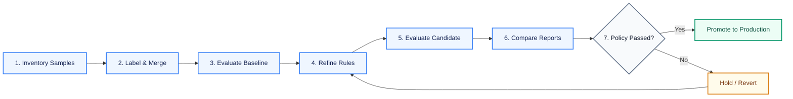

# Local Analyst Workflow — Operations Guide

## Overview

The operational entry point is `malyz3r-workbench` (or `python -m malware_scanner.workbench`). This is a **local single-user application**, not a hosted multi-user service. Run it in the analyst environment where the sample corpus is stored.

**Key Principles:**
- Does not upload samples or execute their contents
- Persistent evidence with reproducible runs
- Quality gate enforcement before promotion
- Baseline comparison for regression detection

---

## Workflow Overview



---

## Phase 1: Inventory Real Files

### Basic Inventory

Scan a folder, record file sizes, compute SHA256 hashes, and output an analyst-labeled manifest:


*Figure: Workbench inventory interface showing file scanning and hash computation (demo screenshot)*

```bash
malyz3r-workbench inventory /analysis/incoming \
  --output manifests/incoming.json \
  --provenance "Case 42, analyst collection"
```

**What is Recorded:**
- File sizes
- SHA256 hashes
- Source paths
- Provenance strings
- Duplicates
- Skipped files
- Errors
- Truncation

**What is NOT Done:**
- Files are not copied
- Files are not modified
- Symlinks and directory links are skipped
- No classification (labels default to `unknown`)

**Defaults:**
- 10,000 files maximum
- 64 MiB per file maximum
- Output must be outside input directory
- Output must not already exist

### Labeling Collections

**Only label a collection when its ground truth is justified.** A filename, YARA hit, or vendor score alone is not ground truth.

```bash
# Benign collection
malyz3r-workbench inventory /analysis/clean \
  --output manifests/clean.json \
  --provenance "Verified vendor distribution; describe verification" \
  --label benign \
  --split held_out

# Target collection
malyz3r-workbench inventory /analysis/family-a \
  --output manifests/family-a.json \
  --provenance "Analyst-adjudicated family A; record evidence" \
  --label target \
  --family family-a \
  --expected-rule family-a.yar:Family_A \
  --split held_out
```

**Merge Disparate Manifests:**

```bash
malyz3r-workbench merge manifests/clean.json manifests/family-a.json \
  --output manifests/evaluation.json
```

**Merge Validation:**
- Rejects conflicting labels
- Rejects missing required hashes
- Rejects incomplete inventories
- Rejects identical content assigned to different splits
- Near-duplicate and time/family-aware separation still require analyst judgment

**Important:**
- Use actual paths and rule IDs (not placeholders)
- Repeat `--expected-rule` for overlapping expected detections
- A label records an assertion, not independent verification
- Preserve source manifests and adjudication evidence
- It does not infer malware families from vendor score, filename, or YARA match

---

## Phase 2: Evaluate with Persistent Evidence

### Supervised Evaluation Run

```bash
malyz3r-workbench run manifests/evaluation.json \
  --rules rules/baseline \
  --runs-dir runs \
  --wall-seconds 300 \
  --memory-mb 512 \
  --policy policies/research-release.json
```

### Run Directory Structure

Each invocation creates a new timestamp/UUID directory:

```
runs/RUN_ID/
  status.json                  # Terminal state, exit code, timestamps, elapsed time, observed RSS
  request.json                 # Effective settings
  policy.json                  # Only when a policy was supplied
  worker.log                   # Worker diagnostics
  progress.json                # Current completed/total counts
  samples.jsonl                # Flushed per-file scan results (useful after failed worker)
  inputs/
    manifest.original.json     # Exact original manifest bytes
    manifest.resolved.json     # Absolute sample paths
    rules/                     # Captured rule sources and includes
  report.json                  # Evaluation and quality-gate result
  metrics.csv                  # Per-rule metrics
  report.html                  # Standalone local report
```

### Inspect Run Status

```bash
malyz3r-workbench inspect runs/RUN_ID
```

**HTML Report:**
- Standalone local file
- Escapes input text
- Lists false detections, missed targets, and scan errors
- Contains local paths and sample hashes (treat as potentially sensitive case material)

### Supervisor Behavior

**What the Supervisor Does:**
- Launches separate Python worker
- Monitors resident memory (RSS)
- Monitors wall time
- Kills worker on limit violation
- On Unix: sets address-space limit
- On Windows: uses RSS polling (can briefly overshoot budget)

**What the Supervisor Does NOT Do:**
- This is **failure containment, not a security sandbox**
- Workers run with analyst's permissions and network access
- Does not protect against native kernel vulnerabilities
- Does not protect against parsing exploits

**Use:**
- Isolated VM
- Restricted account
- Appropriate filesystem/network controls
- Local storage (not untrusted network mounts)

---

## Phase 3: Compare a Rule Revision

### Run Candidate Evaluation

```bash
malyz3r-workbench run manifests/evaluation.json \
  --rules rules/candidate \
  --runs-dir runs
```

### Compare Baseline vs Candidate

```bash
malyz3r-workbench compare runs/BASELINE/report.json runs/CANDIDATE/report.json \
  --output comparison.json
```

### Comparison Requirements

Comparison requires complete reports with:
- Identical sample content hashes
- Identical labels
- Identical expected rule IDs
- Identical splits
- Identical engine version
- Identical scan settings

**What Comparison Reports:**
- New detections
- Missed detections
- New false positives
- Removed false positives
- Metric deltas

**Comparison Validation:**
- Unknown labels cause comparison to fail
- Incomplete inventories cause comparison to fail
- Different corpora cause comparison to fail
- Rule IDs must remain stable across revisions
- Renamed or new rules need separately adjudicated labels (not automatic baseline mapping)

### Replay Against Captured Rules

```bash
malyz3r-workbench run runs/RUN_ID/inputs/manifest.resolved.json \
  --rules runs/RUN_ID/inputs/rules \
  --runs-dir runs/replay
```

**Important:**
- Referenced samples must still be accessible
- SHA256 checks detect changes for pinned samples
- Snapshots retain rule inputs, not sample binaries
- Include files with `.inc` extensions are dependencies
- `.yar`/`.yara` files are compiled as independent entry points

---

## Quality Gates and Exit Codes

### Example Policy Thresholds

The example policy is a starting point for analyst review, **not an industry standard or certification**:

- At least 30 target examples per rule
- At least 4,000 benign files
- Recall >= 0.90
- Benign FPR <= 0.001
- No unknown labels
- Held-out non-synthetic dataset
- Recall's 95% lower bound >= 0.80
- Benign-FPR's 95% upper bound <= 0.001

### Policy JSON Example

```json
{
  "min_recall": 0.90,
  "min_recall_lower95": 0.80,
  "max_benign_fpr": 0.001,
  "max_benign_fpr_upper95": 0.001,
  "min_target_samples": 30,
  "min_benign_samples": 4000,
  "max_unknown_labels": 0,
  "require_held_out": true,
  "reject_synthetic": true,
  "rules": ["rule.yar:RuleName"]
}
```

### Exit Codes

| Exit Code | Meaning |
| :--- | :--- |
| **0** | Completed operation |
| **1** | Incomplete/failed/resource-limited run or incomplete inventory |
| **2** | Invalid command/input |
| **3** | Rejected quality policy or comparison regression |
| **130** | Analyst cancellation |

**Important:**
- Automation must inspect exit code and terminal status
- No policy means **quality not evaluated** (even if scanning completed)
- Undefined recall and insufficient positive evidence fail policies that require recall
- Benign-only FPR is separate from off-target FPR (which includes other families)
- F1 and precision depend on chosen corpus and do not estimate deployment yield
- A passing policy validates only its stated checks

---

## Current Validation Boundary

**What Has Been Exercised:**
- Actual installed Python-package files (including native extension binaries)
- Deterministic fixtures
- Real-file exercises on Windows and Linux

**What Has NOT Been Done:**
- No labeled real-malware corpus has been evaluated
- Hosted CI not verified
- Broad platform validation not complete
- Independent security review not complete
- Representative held-out detection measurements not complete

**Before Production Readiness:**
- Independently labeled malware-family data
- Representative benign data
- Held-out measurements
- Completed hosted CI on published revision
- Independent security review
- Broader platform and workload validation

**Do Not:**
- Promote bundled heuristic rules merely because application runs successfully

---

## Portable Release Validation

### Local Validation

```bash
python -m pip install -c constraints.txt ".[dev]"
python tests/run_validation.py
```

### Docker Validation

```bash
docker build -f Dockerfile.validation -t malyz3r-validation:local .
docker run --rm --network none --read-only \
  --tmpfs /tmp:rw,nosuid,nodev,noexec,size=256m \
  --cap-drop ALL --security-opt no-new-privileges \
  --pids-limit 128 --memory 1g --cpus 2 \
  malyz3r-validation:local
```

**What This Validates:**
- Restricted test profile
- Application runs with restricted privileges
- Not proof of malware detonation or sandbox-escape resistance

### Native-Library Benchmark

```bash
python tests/benchmark_system.py OUTPUT_DIRECTORY
```

**What This Does:**
- Inventories Python extension modules on Linux
- Records assumed-benign provenance
- Performs real-file run

**What This Does NOT Do:**
- Establish malware recall
- Validate production safety

**See [SECURITY.md](../SECURITY.md) for isolation and audit limitations.**

---

## Legacy Configuration and Automation

### Environment Overrides

- Evaluated on each configuration load
- Invalid JSON fails explicitly
- Parallelism outside 1-32 fails explicitly
- `--help` still works with bad settings

### Configuration Saving

- Atomic
- Excludes VirusTotal credential
- Supply `MALYZ3R_VT_API_KEY` in environment for each execution environment

### Shell Script Automation

```bash
scripts/yara_scan.sh SCAN_DIRECTORY RULES_DIRECTORY LOG_FILE
```

**Requirements:**
- All three paths required
- Does not default to scanning entire filesystem
- Set `MALYZ3R_PYTHON` to installed virtual environment's Python if needed

**Limitations:**
- Shares scanner's per-file limits
- Does not have workbench's whole-worker supervision

---

## Common Workflows

### Initial Rule Development

```bash
# 1. Inventory development samples
malyz3r-workbench inventory /analysis/dev-samples \
  --output manifests/dev.json \
  --provenance "Development corpus" \
  --label target \
  --split development

# 2. Evaluate initial rules
malyz3r-workbench run manifests/dev.json \
  --rules rules/initial \
  --runs-dir runs/dev-initial

# 3. Inspect results
malyz3r-workbench inspect runs/dev-initial
# Open report.html in browser

# 4. Refine rules based on findings
# Edit rules/initial/*.yar

# 5. Re-evaluate
malyz3r-workbench run manifests/dev.json \
  --rules rules/initial \
  --runs-dir runs/dev-refined
```

### Production Promotion

```bash
# 1. Prepare held-out corpus
malyz3r-workbench inventory /analysis/held-out \
  --output manifests/held-out.json \
  --provenance "Held-out validation corpus" \
  --label benign \
  --split held_out

# 2. Merge with target samples
malyz3r-workbench merge manifests/target.json manifests/held-out.json \
  --output manifests/production.json

# 3. Evaluate with policy
malyz3r-workbench run manifests/production.json \
  --rules rules/candidate \
  --runs-dir runs/production-eval \
  --policy policies/production.json

# 4. Check exit code
echo $?  # Should be 0 if policy passed

# 5. If passed, promote rules
cp rules/candidate/* rules/production/
```

### Regression Detection

```bash
# 1. Baseline evaluation
malyz3r-workbench run manifests/production.json \
  --rules rules/production \
  --runs-dir runs/baseline

# 2. Make rule changes
# Edit rules/production/*.yar

# 3. Candidate evaluation
malyz3r-workbench run manifests/production.json \
  --rules rules/production \
  --runs-dir runs/candidate

# 4. Compare
malyz3r-workbench compare runs/baseline/report.json \
  runs/candidate/report.json \
  --output comparison.json

# 5. Review comparison.json for regressions
```

---

## Related Documentation

- [README.md](../README.md#detection-engineering-lifecycle-7-phases) — Detection engineering lifecycle
- [LAB.md](../LAB.md) — Evaluator technical details
- [SECURITY.md](../SECURITY.md) — Security boundaries
- [VALIDATION.md](../VALIDATION.md) — Validation record

---

**Last Updated**: 26 October 2026
