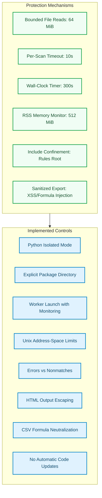
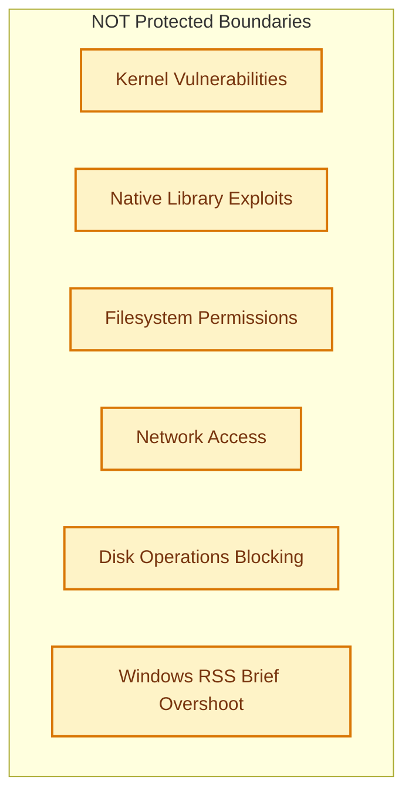

# Security Model and Validation Boundaries

## Overview

malyz3r is a **single-user local analyst application**. File contents are scanned as data, but native YARA and file-parsing dependencies remain attack surfaces. This document details the security model, implemented controls, and validation boundaries.

**Critical Warning**: Do not run untrusted rules or malware collections on a privileged workstation. Use an isolated VM, restricted account, and appropriate filesystem/network controls for adversarial material.

---

## Threat Model

### What IS Protected

### What is NOT Protected

---

## Implemented Controls

### 1. Worker Isolation

**Python Isolated Mode:**
- Worker launch uses Python isolated mode (`-I`)
- Explicitly selected package directory
- Sample folder cannot substitute a same-named Python package
- Interpreter's configured user-site dependency directory retained (when parent uses user-level installation)
- Arbitrary `PYTHONPATH` not inherited

**Process Boundaries:**
- Worker executes in separate Python subprocess
- Supervised by parent process with monitoring
- Not an OS security boundary (no seccomp jail or Firecracker microVM)
- Worker has analyst's permissions and network access

### 2. Resource Bounds

**Memory Monitoring:**
- Worker RSS monitoring (512 MiB default)
- Unix address-space limits (separate from RSS)
- Windows RSS polling can briefly overshoot budget
- Worker killed on limit violation

**Time Limits:**
- Per-scan timeout (10 seconds default)
- Wall-clock timer (300 seconds default)
- Worker killed on deadline exceeded

**File Size Limits:**
- Bounded sample reads (64 MiB default)
- Maximum sample size enforced before scan
- Bounded reads even if file grows during read

### 3. Rule Compilation Security

**Include Confinement:**
- Includes must stay inside selected rule root
- Include path resolution prevents directory traversal
- Ambiguous reused include names rejected
- Rule sources limited to 4 MiB each
- Total rule-source snapshot limited to 32 MiB

**Fingerprinting:**
- Compiled source bytes and included dependencies fingerprinted
- Fingerprints preserved in each run
- Enables reproducible replay and verification

### 4. Output Sanitization

**HTML Reports:**
- Input strings escaped to prevent stored XSS
- Sanitized before rendering
- Safe for local viewing

**CSV Reports:**
- Cells starting with `=`, `+`, `-`, or `@` prefixed with single quote
- Neutralizes spreadsheet formula injection attacks
- Safe for Excel/Google Sheets import

**Distinguished Errors:**
- Scan errors distinguished from nonmatches
- Unknown labels not treated as negatives
- Incomplete reports clearly marked

### 5. Update Safety

**No Automatic Updates:**
- Launcher never updates or pulls code automatically
- Explicit version control required for updates
- Review changes before deployment

---

## Reproducible Security Checks

### Dependency Pinning

**constraints.txt:**
- Records runtime versions used during validation
- Install with: `python -m pip install -c constraints.txt ".[dev]"`
- Version pins are **not** package hashes
- Not a complete supply-chain verification
- Review and update through CI rather than freezing vulnerable versions

### Dependency Auditing

**pip-audit:**
- Automated check for known advisories
- Configured in GitHub Actions
- Reports no known advisories for nine pinned runtime dependencies (as of check time)
- Does not cover unknown flaws
- Does not guarantee complete native-library advisory coverage

### Static Analysis

**Bandit:**
- Medium/high-severity gate in CI
- No medium/high findings reported
- Low-severity warnings remain for:
  - Intentional subprocess use
  - Legacy exception handling
  - Test asserts
- Absence of findings is **not** proof of safety
- Not an independent security audit

### Docker Validation

**Restricted Container Profile:**
- UID 10001 (non-root)
- No network
- Read-only root filesystem
- Dropped capabilities
- No-new-privileges
- Bounded CPU (2 cores)
- Bounded RAM (1 GiB)
- Bounded process count (128)
- Only `/tmp` writable

**What This Validates:**
- Constrained deployment profile
- Application runs with restricted privileges
- No proof of sandbox escape resistance
- Not for unrestricted malware detonation

---

## Data Privacy Controls

### Local Data Protection

**Keep Private:**
- Private samples
- Manifests
- Run reports
- Client identifiers
- Out of public Git history

**Reports Contain:**
- Local paths
- Sample hashes
- Potentially sensitive case material

**No Sample Upload:**
- Lab does not require sample-upload capability
- Optional VirusTotal feature queries hashes only
- No sample transmission to external services

### AI Assistant Privacy

**What IS Sent:**
- Selected development metrics
- Case identifiers (opaque IDs)
- Labels and expected/matched rule IDs
- Matched string identifiers (not bytes)
- Rule source text (only with explicit opt-in)

**What is NOT Sent:**
- Sample bytes
- Sample paths
- Sample hashes
- Provenance fields
- Private evidence map

**Split Isolation:**
- Held-out data blocked before any request
- Mixed partitions rejected
- Unspecified splits rejected
- Only development split permitted

**See [ASSISTANT.md](../ASSISTANT.md) for details.**

### MCP Integration Privacy

**Default Mode:**
- Local stdio evidence reader
- No provider network calls
- No API key required

**Network Mode (Opt-in):**
- Requires `--allow-network --model <ID>`
- Requires `confirm_send=true`
- Flag is not proof of human approval
- Use IDE's approval controls

**Path Confinement:**
- Paths confined to configured workspace
- Workspace-based boundary enforcement

**See [MCP.md](../MCP.md) for details.**

---

## Auxiliary Scanner Hardening

### VirusTotal Integration

**Safety Controls:**
- Rejects redirects
- Rejects oversized/malformed responses
- Returns failure on missing credentials
- Returns failure on unreadable files

**OPSEC Warning:**
- Querying proprietary hashes may expose confidential data
- Free-tier rate limited to 4 requests/minute
- Consider OPSEC implications before use

### Configuration Management

**Validation:**
- Parallelism validated at load time (1-32 range)
- Invalid JSON reported explicitly
- Updates atomic
- VirusTotal key omitted when saved
- Invalid config reported instead of silent defaults

**Environment:**
- Supply `MALYZ3R_VT_API_KEY` in environment
- Not stored in repository files
- Not in command arguments
- Not in reports or chat messages

### File Investigation

**Hardening:**
- Reads at most 1 MiB
- Displays bounded printable strings
- Displays 256 bytes of hex
- ExifTool has 30-second deadline
- Monitored 1 MiB output cap
- Temporary output can briefly exceed cap between checks

**Not a Sandbox:**
- Controls are not a sandbox for external/native parser
- File-type detection reads 64 KiB prefix
- PE certificate-table presence does not verify signature or trust

---

## Validation Boundaries

### What IS Established

**Application Checks:**
- 31 unit/integration tests passing locally (Windows and Linux, Python 3.13)
- Strict fixture gate
- Lint, format, dependency consistency
- Installed package smoke test
- Supervisor tests (hung child, excessive RSS, failed compilation, persisted evidence, package shadowing)

**Real-File Exercises:**
- Windows: 121 installed package files scanned without errors or matches
- Linux: 78 native Python extension modules scanned without errors or matches
- These are **assumed-benign software references**, not independently adjudicated security datasets
- Neither exercise measures malware recall

**Security Automation:**
- pip-audit: No known advisories for nine pinned runtime dependencies
- Bandit: No medium/high-severity issues
- CI includes dependency auditing, static-analysis gate, restricted container run

### What is NOT Established

**Not Validated:**
- Hosted GitHub Actions success on pushed revision (changes remain local)
- Windows Python 3.10 execution locally (Linux Python 3.10 verified)
- Independently labeled malware-family recall
- Representative held-out FPR
- Independent penetration testing
- Sandbox escape resistance
- External security review
- Suitability for multi-user hosted deployment (target remains local CLI)

**Advisory Limitations:**
- Advisory data can be incomplete
- Especially for native libraries
- No complete native-library advisory coverage

**Small Corpora:**
- Small corpora with zero observed matches do not establish low population FPR
- Sampling bias and correlated files remain limitations
- Wilson intervals do not correct biased sampling

---

## Recommended Operational Security

### For Adversarial Material

**Use:**
- Isolated VM
- Restricted account
- Appropriate filesystem controls
- Network controls
- Air-gapped environment for sensitive investigations

**Do Not:**
- Run on privileged workstation
- Run on host OS with sensitive data
- Use untrusted network mounts
- Share reports with untrusted parties without review

### For Production Deployment

**Before Deployment:**
- Independently labeled malware-family data
- Representative benign data
- Held-out measurements
- Completed hosted CI on published revision
- Independent security review
- Broader platform and workload validation

**Do Not:**
- Promote bundled heuristic rules merely because application runs successfully
- Assume synthetic fixture success implies real-world efficacy
- Deploy without local tuning and validation

---

## Incident Response

If a security incident is suspected:

1. **Isolate the System:**
   - Disconnect from network
   - Stop running processes
   - Preserve memory and disk state

2. **Collect Evidence:**
   - Run directories (`runs/`)
   - Manifest files
   - Configuration files
   - Sample corpora
   - Logs

3. **Report:**
   - Document the incident
   - Note the malyz3r version and validation date
   - Include sample manifests and run reports
   - Submit via [GitHub Security Advisories](https://github.com/gl1tch0x1/malyz3r/security/advisories)

---

## Related Documentation

- [SECURITY.md](../SECURITY.md) — Original security documentation
- [VALIDATION.md](../VALIDATION.md) — Dated validation record
- [ASSISTANT.md](../ASSISTANT.md) — AI assistant privacy controls
- [MCP.md](../MCP.md) — MCP integration security
- [README.md](../README.md#threat-model--security-considerations) — Threat model diagram

---

**Last Updated**: 26 October 2026
